# FAKE.NET Billing and Office ISP

Billing standalone ISP/RT-RW Net berbasis Node.js untuk operasional pelanggan PPP-DHCP, Hotspot voucher, tagihan, monitoring, payment gateway, Whatsapp Gateway, GenieACS, aset, inventaris, dan laporan.

Data runtime tidak disertakan ke repository. Folder `data/` diabaikan oleh Git kecuali `.gitkeep`, sehingga data dev/produksi tidak ikut terupload.

## Quick Install

Gunakan VM/VPS Debian/Ubuntu baru berbasis systemd. Minimal yang disarankan adalah Ubuntu 22.04 LTS atau Debian 12. Jalankan semua perintah sebagai `root`.

### Ubuntu/Debian

```bash
apt update
apt install -y git curl
cd /root
git clone https://github.com/fakehotspot12/FAKE.NET-BILLING.git
cd FAKE.NET-BILLING
bash install.sh
```

Untuk VM kecil atau jika sudah memakai GenieACS existing, jalankan instalasi ringan:

```bash
INSTALL_GENIEACS=0 bash install.sh
```

Setelah installer selesai, buka:

```text
http://IP-SERVER:8891
```

Login awal:

```text
username: admin
password: lihat output akhir installer
```

Installer membuat password admin acak pada instalasi baru dan menyimpannya di `/etc/fakenet-billing.env` dengan izin root-only. Segera ubah password admin setelah berhasil login.

Port bawaan:

```text
Billing admin : http://IP-SERVER:8891
Web isolir    : http://IP-SERVER:8892/isolir
Beli voucher  : http://IP-SERVER:8893/voucher
WifiKu        : http://IP-SERVER:8894/wifiku
WAHA lokal    : 127.0.0.1:8895
GenieACS CWMP : http://IP-SERVER:7547
GenieACS NBI  : 127.0.0.1:7557
GenieACS UI   : http://IP-SERVER:7568
```

Login awal GenieACS UI adalah `billing` / `billing123`. Autentikasi Inform CPE adalah `admin` / `1sampai10`. Ubah kredensial awal setelah instalasi dan batasi akses UI menggunakan firewall/VPN atau reverse proxy ber-HTTPS.

Cek status service:

```bash
fakenet-billing-stack status
```

Restart semua service:

```bash
fakenet-billing-stack restart
fakenet-billing-stack restart-app
```

Update aplikasi:

```bash
fakenet-billing-stack update
fakenet-billing-stack clear-update-lock
```

Repair konfigurasi service/FreeRADIUS tanpa hapus data:

```bash
cd /root/FAKE.NET-BILLING
sudo bash install.sh repair
```

Uninstall total:

```bash
cd /root/FAKE.NET-BILLING
sudo bash install.sh uninstall
```

Hal yang perlu diatur setelah install:

- Aktivasi aplikasi melalui halaman aktivasi jika diminta.
- Ubah password admin.
- Isi data usaha, logo, dan subdomain publik jika dipakai.
- Tambahkan NAS, secret Radius, SNMP community, dan profile layanan.
- Atur Payment Gateway.
- Aktifkan dan scan Whatsapp Gateway dari menu aplikasi jika ingin memakai pengiriman WA. Pada instalasi baru, gateway WA sengaja default `disable` sampai owner mengaktifkannya.
- Buat rule MikroTik untuk Radius, isolir, dan redirect web isolir sesuai kebutuhan jaringan.

Installer juga menyiapkan Tesseract OCR untuk pembacaan Nomor KTP dari foto pelanggan. Jika paket OCR belum tersedia, pastikan repository Ubuntu/Debian aktif lalu jalankan `sudo bash install.sh repair`.

## Fitur Utama

- Dashboard keuangan, tagihan, PPP-DHCP users, Hotspot users, dan traffic NAS.
- Radius PPP-DHCP dan Hotspot: user, profile, session, import/export, generate voucher, kick session, isolir/aktif/terminate.
- Billing mandiri: invoice otomatis/manual, reminder, bayar, rollback, PDF kuitansi, laporan harian/bulanan.
- Voucher Hotspot online: order dari login page, pembayaran QRIS, generate voucher otomatis setelah paid, dan cetak voucher batch.
- Payment Gateway terpusat untuk paket bulanan dan voucher. Provider awal: Tripay, struktur siap untuk provider lain.
- Whatsapp Gateway API memakai WAHA lokal: template, pesan terkirim, resend, broadcast, dan notifikasi tagihan/voucher.
- Monitoring: NAS, pelanggan online, tagihan pelanggan, member, dan GenieACS.
- GenieACS lokal: manajemen ONU, redaman, suhu, status perangkat, provisioning WAN, binding LAN/SSID, pengaturan WiFi, reboot, dan portal WifiKu.
- Portal publik:
  - Isolir untuk pelanggan yang ditangguhkan.
  - Voucher untuk pembelian voucher Hotspot.
  - WifiKu untuk pelanggan melihat usage bulanan, redaman, ganti SSID/password, dan reboot ONU jika GenieACS aktif.
- Manajemen aset, inventaris, stok, mutasi stok, notifikasi stok/aset bermasalah.
- Role user: admin, sekretaris, owner, finance, teknisi, NOC, collector, reseller voucher, viewer.
  Sekretaris adalah administrator kedua dengan seluruh izin Admin, termasuk
  pengelolaan pengguna, pengaturan, pembayaran, dan perangkat. Nama role dan
  identitas pelaku di audit tetap Sekretaris, bukan diganti menjadi Admin.
- Backup/restore dan update aplikasi dari menu Pengaturan.

## Tampilan Aplikasi

Screenshot berikut memakai data yang disamarkan untuk dokumentasi publik.

| Dashboard | Pelanggan Online |
| --- | --- |
| 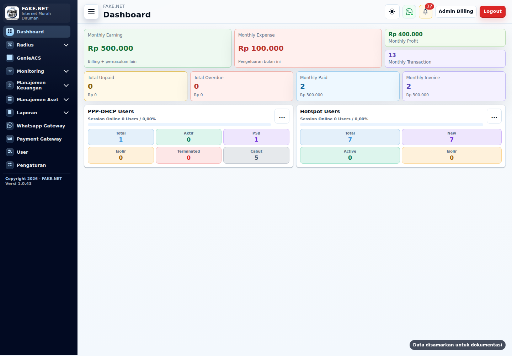 | 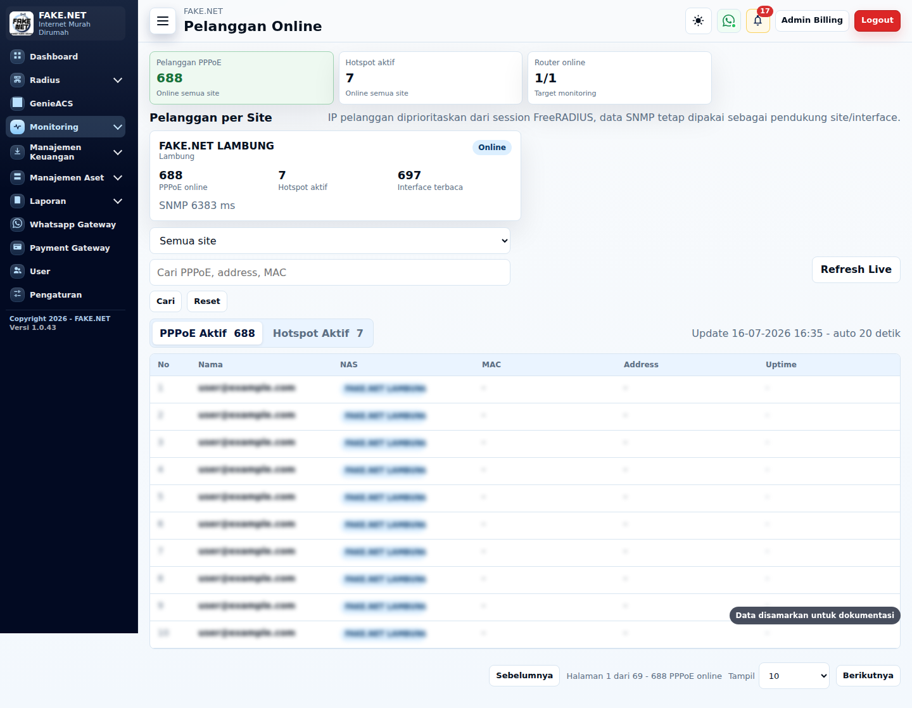 |

| Radius PPP-DHCP | Hotspot Voucher |
| --- | --- |
| 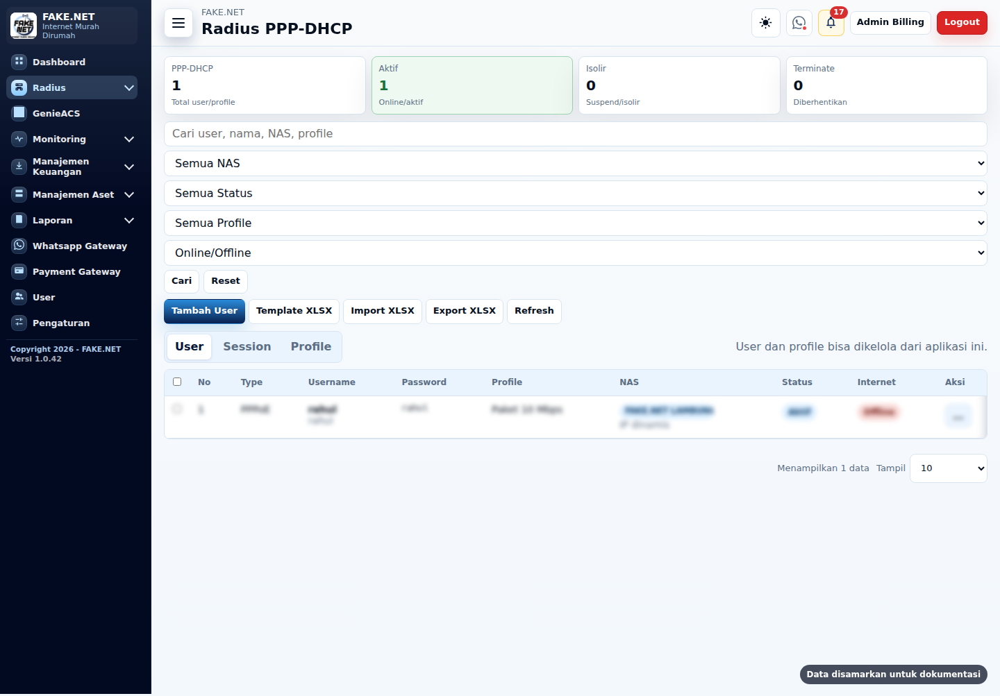 | 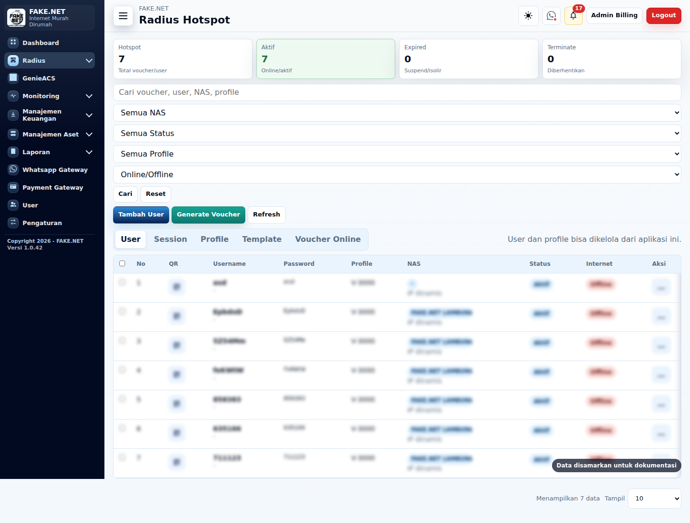 |

| Member | Tagihan Pelanggan |
| --- | --- |
| 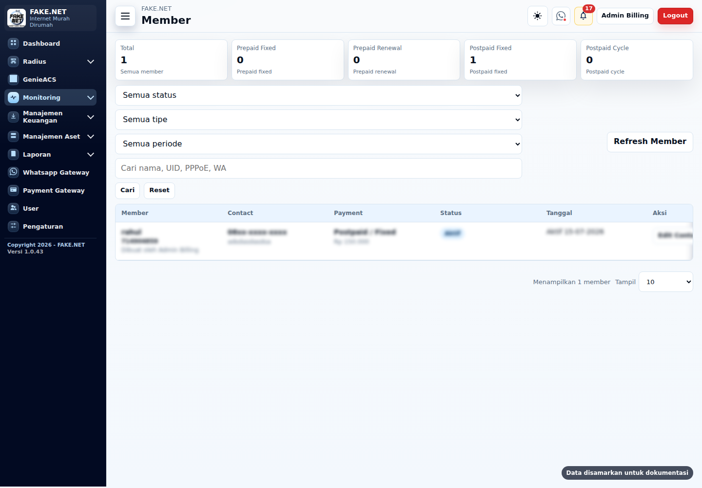 | 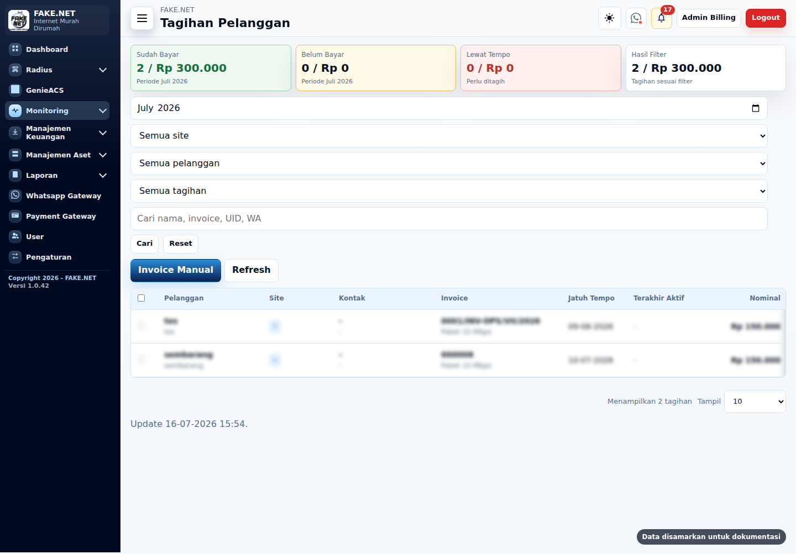 |

| Statistik | GenieACS |
| --- | --- |
| 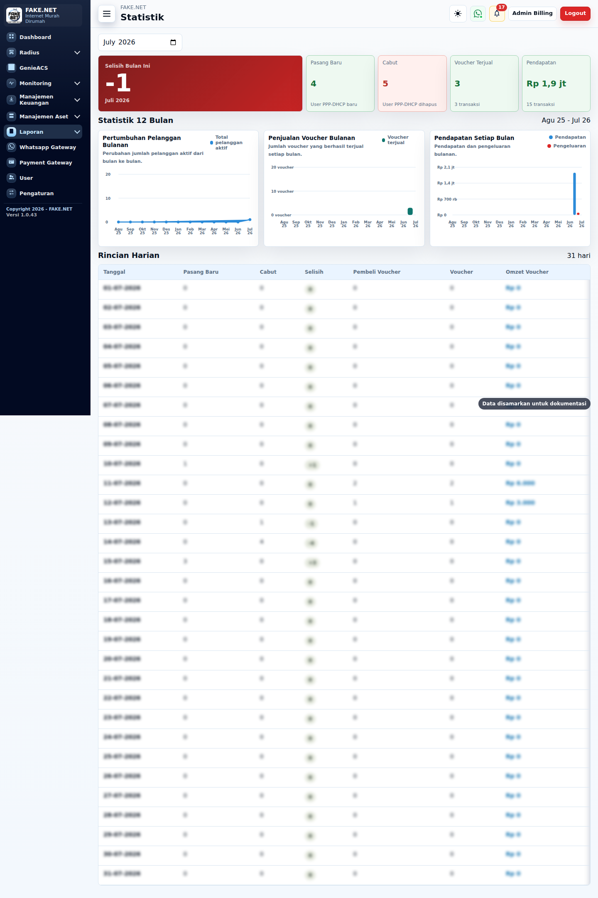 | 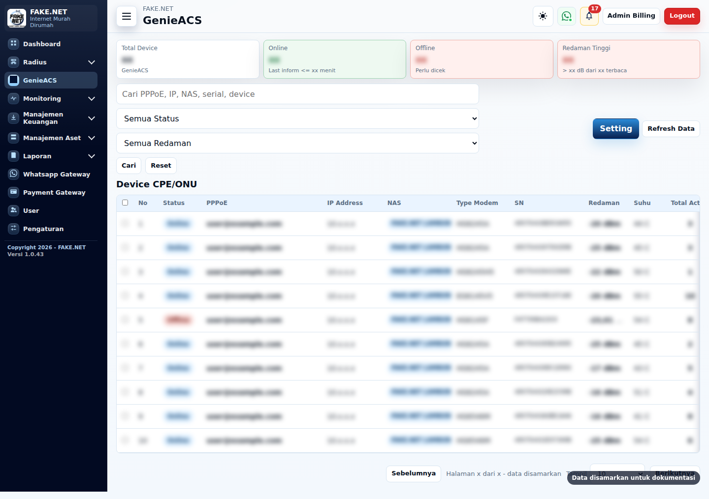 |

| Whatsapp Gateway | Payment Gateway |
| --- | --- |
| 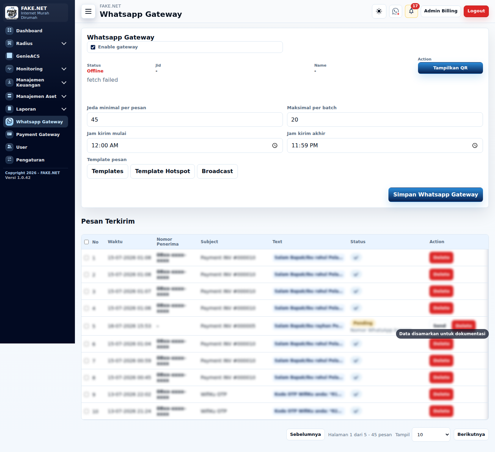 | 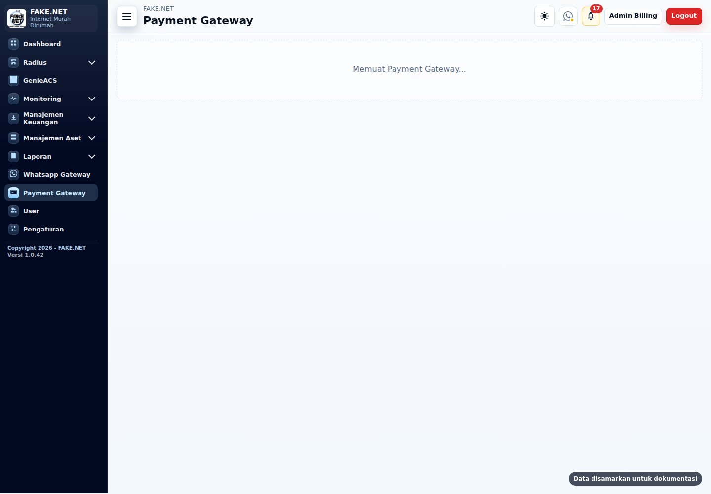 |

| Mobile Dashboard |
| --- |
| 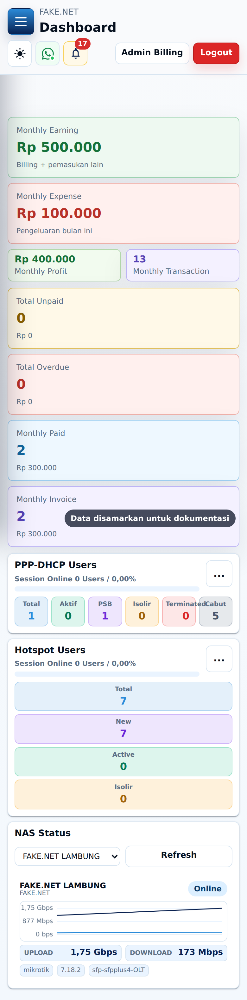 |

## Member PPP-DHCP

Member PPP-DHCP digunakan untuk pelanggan bulanan seperti PPPoE dan DHCP yang ditagihkan secara periodik. Data pelanggan dibuat dari wizard akun, member, payment, dan review sehingga informasi teknis internet, identitas pelanggan, nomor Whatsapp, alamat, titik lokasi peta, foto rumah, profile layanan, NAS, serta detail pembayaran tersimpan dalam satu alur.

Saat user PPP-DHCP dibuat, aplikasi dapat sekaligus membuat data member dengan ID pelanggan otomatis. Profile PPP-DHCP menyimpan harga paket, mode billing, VAT, diskon, dan parameter bandwidth atau link ke profile Mikrotik. Data autentikasi dan session menggunakan FreeRADIUS, sehingga status online/offline, kick session, suspend, aktif kembali, dan terminated tidak hanya tampil di aplikasi tetapi juga terkait dengan backend Radius.

Alur operasional member PPP-DHCP:

1. Admin, NOC, teknisi, collector, atau role yang diberi izin membuat atau mengubah user PPP-DHCP sesuai kewenangannya.
2. Sistem menyimpan data akun internet, data kontak member, detail pembayaran, dan profile layanan.
3. Invoice dapat dibuat otomatis sesuai billing setting atau manual dari menu tagihan.
4. Reminder tagihan dikirim melalui Whatsapp Gateway berdasarkan template yang bisa diatur.
5. Pembayaran bisa dicatat manual oleh user berwenang atau diterima otomatis dari payment gateway.
6. Jika invoice sudah paid, pelanggan tetap aktif dan tidak ikut proses isolir.
7. Jika melewati jatuh tempo sesuai pengaturan, sistem dapat melakukan isolir otomatis dan mengirim notifikasi.
8. Pelanggan yang sudah membayar setelah isolir dapat diaktifkan kembali, termasuk trigger session/COA Radius bila tersedia.

Data lokasi pelanggan dapat disimpan dari izin lokasi browser atau ditandai manual pada peta. Foto rumah pelanggan disimpan sebagai referensi lapangan agar teknisi, NOC, dan collector lebih mudah menemukan titik pemasangan, memverifikasi pelanggan pindah alamat, atau melengkapi data saat kunjungan. Foto otomatis dioptimalkan ke WEBP, dideduplikasi, dan file yang tidak lagi digunakan dibersihkan setelah masa aman. Di menu Member, data kontak, alamat, peta, foto rumah, detail internet, dan invoice dibuat mudah ditinjau tanpa membuka banyak halaman.

Untuk pendataan pelanggan baru, foto KTP dapat diupload oleh role yang berwenang seperti admin atau teknisi. Aplikasi akan mencoba membaca NIK menggunakan OCR lokal, lalu mengisi field Nomor KTP otomatis jika terbaca. Foto KTP disimpan di storage privat aplikasi dan tidak diekspos sebagai file publik, sehingga tetap bisa dipakai untuk verifikasi administrasi tanpa bercampur dengan asset web.

Status **Data Valid** member hanya memeriksa nama pelanggan, alamat, koordinat
yang valid dan bukan nol, serta foto rumah. Nama di KTP, nomor KTP dan foto KTP
tidak menjadi syarat atau item checklist validasi. Field KTP, OCR dan unggahannya
tetap tersedia bagi petugas berwenang tanpa menghapus arsip yang sudah ada.

Monitoring member PPP-DHCP memuat status pelanggan, status pembayaran, NAS, kontak, alamat, invoice, serta data pendukung untuk pekerjaan lapangan. Portal WifiKu dapat digunakan pelanggan untuk melihat pemakaian bulanan, redaman, dan aksi perangkat jika integrasi GenieACS aktif.

## Metode Pembayaran Member

Billing member memakai kombinasi `Payment Type` dan `Billing Period`. Pilihan periode billing dibatasi berdasarkan tipe pembayaran agar skema tagihan tidak rancu.

| Payment Type | Billing Period | Sumber jatuh tempo | Cara kerja invoice | Cocok untuk |
| --- | --- | --- | --- | --- |
| Postpaid | Fixed Date | Tanggal jatuh tempo milik member, biasanya mengikuti tanggal aktif/pasang pelanggan. | Pelanggan memakai layanan lebih dulu. Invoice dibuat sesuai tanggal member tersebut, lalu pembayaran dicatat manual atau otomatis dari payment gateway. | Pelanggan bulanan yang tanggal tagihannya berbeda-beda mengikuti tanggal pasang. |
| Postpaid | Billing Cycle | Tanggal global `Due date postpaid` di `Radius > Setting > Billing Setting`. | Semua pelanggan cycle ditarik ke tanggal jatuh tempo yang sama. Jika pelanggan aktif sebelum/sesudah tanggal cycle, invoice pertama dapat prorata, lalu periode berikutnya full bulanan. | ISP yang ingin semua tagihan jatuh pada tanggal seragam, misalnya tanggal 10 atau 15 setiap bulan. |
| Prepaid | Fixed Date | Tanggal jatuh tempo milik member. | Pelanggan bayar dulu untuk periode tanggal tetap. Jika invoice awal `Unpaid`, layanan belum dianggap aman sampai pembayaran dicatat `Paid`. | Pelanggan prabayar yang tetap memakai tanggal jatuh tempo tertentu. |
| Prepaid | Renewal | Masa aktif/expired terakhir pelanggan, lalu diperpanjang setelah pembayaran berikutnya. | Pelanggan bayar dulu, lalu masa aktif diperbarui dari periode renewal. Tidak memakai tanggal cycle global. | Skema prabayar berbasis perpanjangan masa aktif, mirip voucher/langganan yang diperpanjang ketika bayar. |

Kombinasi yang tidak sesuai tidak digunakan. `Postpaid + Renewal` dan `Prepaid + Billing Cycle` akan dinormalisasi ke `Fixed Date` agar data tetap aman dan invoice tidak dibuat dengan aturan yang salah.

### Billing Cycle dan Prorata

Untuk `Postpaid + Billing Cycle`, tanggal jatuh tempo mengikuti pengaturan `Due date postpaid` di menu `Radius > Setting > Billing Setting`. Jika pelanggan baru aktif sebelum atau sesudah tanggal cycle, invoice pertama dihitung prorata dari `Active Date` sampai tanggal jatuh tempo cycle pertama. Setelah invoice pertama, tagihan berikutnya kembali normal full bulanan.

Contoh:

```text
Harga paket       : Rp150.000
Active Date       : 20/07/2026
Billing Cycle     : tanggal 15
Jatuh tempo awal  : 15/08/2026
Jumlah hari       : 27 hari
Tagihan awal      : Rp150.000 x 27 / 30 = Rp135.000
```

Invoice berikutnya setelah periode prorata akan memakai nominal full `Rp150.000` per bulan, kecuali ada VAT/PPN atau diskon pada data member. Jika VAT/PPN dan diskon diisi, aplikasi menghitungnya dari subtotal tagihan periode tersebut, termasuk subtotal prorata.

### Billing Setting

Field tanggal di Billing Setting berfungsi sebagai berikut:

- `Due date postpaid`: tanggal jatuh tempo global untuk `Postpaid + Billing Cycle`.
- `Generate invoice sebelum tempo`: jumlah hari sebelum jatuh tempo saat invoice otomatis mulai dibuat. Nilai `1` berarti H-1, nilai `0` berarti tepat hari jatuh tempo.
- `Reminder sebelum tempo`: jumlah hari sebelum jatuh tempo untuk mengirim pengingat Whatsapp. Nilai `0` berarti reminder otomatis dimatikan.
- `Grace suspend setelah tempo`: masa tenggang setelah jatuh tempo sebelum pelanggan diisolir otomatis. Nilai `0` berarti auto isolir karena telat bayar dimatikan.
- `Terminate otomatis setelah isolir`: jumlah hari sejak isolir otomatis sebelum akun PPP-DHCP diubah menjadi terminated. Nilai `0` adalah default: pelanggan tetap isolir dan invoice periode berikutnya terus diterbitkan.
- `Jam kirim invoice/reminder`: jam pengiriman WA invoice terbit dan reminder otomatis. Default `08:00` agar pelanggan menerima pesan pada jam aktif kerja.
- `Jam isolir otomatis`: jam eksekusi isolir otomatis setelah masa tenggang terpenuhi. Default `13:30` agar isolir tidak berjalan tengah malam dan admin masih siap menangani konfirmasi.

Invoice otomatis dibuat per pelanggan sesuai tanggal jatuh temponya masing-masing. Untuk pelanggan prorata Billing Cycle, invoice pertama tidak dibuat sebelum `Active Date`, meskipun window generate invoice sudah masuk H-minus jatuh tempo.

Jika batas terminate diisi lebih dari `0`, hanya isolir yang dibuat sistem karena tunggakan yang dapat berubah otomatis menjadi terminated. Isolir manual oleh admin tidak ikut diproses. Setelah terminated, invoice baru berhenti dibuat tetapi invoice terakhir yang belum lunas tetap tersimpan dan dapat dibayar. PPP-DHCP terminated tetap diarahkan ke profile/group isolir Radius agar halaman isolir dan tombol pembayaran dapat diakses. Pembayaran tidak langsung mengaktifkan akun terminated; aktivasi kembali harus dikonfirmasi admin. Voucher Hotspot terminated tetap diblokir dan tidak mendapatkan akses portal.

Pada `Radius > Setting`, field Rate Limit/Group MikroTik/IP Pool Isolir boleh dikosongkan. Jika semua field isolir kosong, akun yang berstatus isolir/terminated akan disinkronkan ke FreeRADIUS sebagai `Auth-Type := Reject` sehingga login ditolak. Jika ingin pelanggan tetap diarahkan ke web isolir, isi Group MikroTik atau IP Pool isolir sesuai profile/router yang sudah disiapkan.

### Janji Bayar

Fitur ini **nonaktif secara default**. Aktifkan `Aktifkan Janji Bayar` di `Radius > Setting > Billing Setting`, di sebelah pengaturan Merge Invoice. Setelah aktif, petugas yang berwenang dapat membuka tindakan Janji Bayar pada invoice belum lunas di Monitoring Tagihan Pelanggan; akses collector tetap mengikuti pelanggan/NAS yang diizinkan.

- Tanggal maksimal adalah satu bulan kalender dari jatuh tempo tunggakan tertua, bukan dari tanggal perubahan janji. Tanggal akhir bulan disesuaikan ke hari terakhir bulan berikutnya jika diperlukan.
- Contoh: jatuh tempo 25 Oktober, janji bayar 30 Oktober. Tagihan tercakup ditahan sampai akhir 30 Oktober. Jika masih belum dibayar, isolir diproses mulai 31 Oktober pada jam isolir otomatis yang diatur, tanpa tambahan masa tenggang.
- Tanggal, periode, nominal, dan status pembayaran invoice asli tetap. Invoice lain yang belum dicakup janji tetap mengikuti aturan billing biasa.
- Ringkasan di bawah Catatan menampilkan jadwal yang sudah tersimpan, bukan tanggal hari ini atau calon janji yang sedang dipilih. Tanpa janji, ringkasan mengikuti jatuh tempo dan masa tenggang normal; perubahan tanggal baru berlaku setelah Simpan.
- Jika pelanggan sudah isolir, simpan tanggal Janji Bayar terlebih dahulu lalu gunakan **Aktifkan Sementara**. Menyimpan janji tidak otomatis membuka isolir. Selama fitur Janji Bayar aktif, aktivasi sementara pelanggan mengikuti janji yang masih berlaku dan tidak membuat pengecualian isolir tanpa batas. Jika belum lunas, isolir kembali H+1 pada jam billing.
- Pengecualian isolir khusus yang sudah ditetapkan tetap diprioritaskan dan tidak diubah oleh update. Akun terminated/nonaktif memerlukan proses aktivasi tersendiri. Jika fitur Janji Bayar dinonaktifkan, mekanisme aktivasi manual sebelumnya tetap berlaku.
- Pembayaran menyelesaikan janji ketika seluruh tagihan tercakup sudah lunas. Pembatalan janji mengembalikan aturan isolir normal. Menonaktifkan fitur saat ada janji aktif memerlukan konfirmasi pembatalan.
- Riwayat janji tersimpan pada audit internal. Fitur memakai scheduler existing tanpa polling jaringan tambahan.

## Voucher Hotspot

Voucher Hotspot dirancang untuk operasional jual voucher harian/mingguan/bulanan tanpa input manual berulang. Admin atau reseller dapat membuat voucher satuan maupun batch dari profile Hotspot yang sudah memiliki harga, validity, quota, shared user, NAS, dan expired mode.

Alur voucher online:

1. Pelanggan membuka halaman beli voucher dari subdomain/port Voucher.
2. Pelanggan memilih paket voucher Hotspot yang tersedia.
3. Sistem membuat order dan mengarahkan pembayaran ke payment gateway.
4. Untuk voucher online, metode pembayaran dipatenkan ke QRIS.
5. Setelah payment gateway mengirim status paid ke webhook, sistem membuat voucher otomatis dengan format username sama dengan password.
6. Voucher dapat dikirim melalui Whatsapp Gateway jika notifikasi voucher diaktifkan.
7. Transaksi voucher paid masuk ke laporan voucher harian/bulanan dan pendapatan reseller sesuai role pembuat voucher.

Pada instalasi dengan beberapa NAS, tautan beli voucher di setiap captive portal wajib membawa NAS tujuan agar paket dan voucher tidak bercampur antar-NAS. Nilainya dapat memakai ID, nama, atau alamat NAS yang terdaftar, misalnya:

```text
http://IP-SERVER:8893/voucher?nas=NAS-CONTOH
http://IP-SERVER:8893/voucher?nas=NAS-CABANG
```

Portal mengunci paket dan order ke NAS tersebut. Jika parameter `nas` tidak ada, portal tidak menampilkan paket global dan meminta pelanggan memilih NAS sebagai fallback.

Voucher batch untuk operasional loket/reseller dapat dicetak langsung dari aplikasi. Format print dibuat ringkas agar satu kertas A4 dapat memuat banyak voucher, lengkap dengan nama usaha, paket, harga, tanggal, jam, QR code, dan link login Hotspot.

Untuk role reseller voucher, data dibuat terpisah berdasarkan pembuat voucher dan NAS yang dikunci pada user tersebut. Reseller hanya melihat, mencetak, dan mengelola voucher yang dibuat olehnya sendiri, sehingga stok voucher, transaksi, dan pendapatan reseller tidak tercampur dengan reseller lain. Admin dan role yang diberi kewenangan lebih tinggi tetap dapat melakukan audit sesuai kebutuhan operasional.

Expired mode mengikuti profile Hotspot, misalnya `None`, `Remove`, `Remove & Record`, `Notice`, dan `Notice & Record`. Mode `Remove & Record` akan menghapus user voucher setelah masa aktif habis tetapi tetap menyimpan record laporan, sedangkan mode notice mempertahankan data user dengan status yang sesuai.

## Monitoring OLT CDATA

- Menu **Monitoring > OLT** menyediakan tambah/edit OLT secara manual: nama,
  IP manajemen, port, community SNMP baca, NAS, dan koordinat opsional.
- Tahap awal mendukung CDATA GPON dengan MIB enterprise `17409`. Monitoring dasar
  memakai SNMP v2c GETBULK tanpa SET. Paket `snmp` menyediakan `snmpbulkwalk`.
- Status ONU dibedakan menjadi Online, LOS, Dying Gasp, dan Other. Akun CLI opsional
  di form OLT membaca satu daftar `show ont status-count` per siklus, bukan per ONU.
  LOS/Dying Gasp hanya ditampilkan jika dilaporkan OLT. Penyebab yang tidak tersedia
  masuk Other dengan penanda belum terbaca, bukan ditebak dari redaman.
- Dashboard menampilkan ringkasan status, filter NAS, kesehatan tiap OLT, dan port
  PON yang dapat diklik. Daftar ONU memakai pencarian dan pagination server-side;
  tidak ada polling SNMP/CLI baru setiap kali membuka halaman atau mengganti filter.
- Status PON/ONU, serial, model, redaman RX, dan jarak dibaca di latar belakang.
  Cache diperbarui bergilir sekitar tiga menit; halaman tidak memicu walk baru.
  Kegagalan pembacaan ditandai dan data terakhir dipertahankan, bukan dianggap nol.
  Field yang memang tidak tersedia ditampilkan `-`.
- Admin, sekretaris, owner, dan NOC mengelola koneksi OLT. Teknisi dapat melihat
  monitoring, menautkan ONU ke pelanggan/ODP, dan menangani tiket gangguan.
  Admin/owner/NOC, teknisi, dan sekretaris dapat reboot atau hapus satu ONU lewat CLI jika
  akun CLI diaktifkan admin. Batas NAS teknisi tetap berlaku. Community/password
  CLI tersimpan terenkripsi dan tidak dikembalikan melalui API. Menu OLT tersedia
  untuk semua role selain finance dan reseller (termasuk Mitra/Reseller). Collector
  dan viewer hanya melihat monitoring. Sekretaris memiliki izin setara Admin;
  seluruh aksi perangkat tetap memerlukan konfirmasi dan verifikasi yang sama.
  Menu tiket tersedia untuk semua role selain collector dan reseller. Finance dan
  viewer hanya membaca tiket; penanganan tetap mengikuti izin petugas yang ada.
- Hapus ONU membutuhkan konfirmasi serial dan persetujuan dampak layanan. Server
  memeriksa serial terbaru melalui SNMP dan sekali lagi lewat CLI sebelum aksi.
  Tidak ada hapus massal, perintah bebas, auto-delete, atau reboot saat polling.
  Jika SN sama muncul di beberapa PON, aksi dikunci pada posisi OLT/PON/ID ONU
  dari baris yang dipilih, bukan seluruh ONU dengan SN tersebut. Permintaan lama
  tanpa posisi ditolak bila ambigu. Peringatan ranging pada ONU offline tidak
  dianggap kegagalan identitas jika SN masih terbaca dan terverifikasi. ONU yang
  terbukti sudah tidak terdaftar ditandai demikian tanpa mengirim hapus ulang.
  Member, invoice, pembayaran, dan riwayat tiket tidak ikut dihapus. Tidak ada
  perintah save/write konfigurasi global otomatis. Aksi masuk audit internal.
  Installer/update menyertakan klien `telnet`, bukan service tambahan. Batasi akses
  manajemen OLT ke LAN/VPN karena Telnet tidak mengenkripsi jalur koneksi.
- Koordinat yang diisi muncul pada peta pelanggan dan jaringan fiber. Penautan ONU
  ke pelanggan/ODP dilakukan eksplisit, tidak menebak identitas dari nama ONU.
- ONU yang dilaporkan LOS otomatis dibuatkan tiket di **Monitoring > Tiket Layanan**,
  terhubung ke OLT/PON/serial dan pelanggan/ODP bila sudah ditautkan. Dying Gasp,
  Other, data lama, dan pembacaan gagal tidak membuat tiket LOS. Satu gangguan
  yang belum pulih tidak membuat tiket berulang, termasuk setelah restart.
  Tiket aktif yang sudah ada digunakan kembali, bukan digandakan.
- LOS baru harus terbaca **tiga kali berturut-turut pada pembacaan baru**, dengan
  jarak hitungan minimal tiga menit, sebelum membuat tiket atau mengantrekan WA.
  Normalnya konfirmasi membutuhkan sekitar enam menit sejak pertama terdeteksi,
  ditambah waktu menunggu polling pertama. Refresh cepat dan cache yang sama
  tidak menambah hitungan. Online, Dying Gasp, status tidak diketahui atau ONU
  hilang pada inventory yang valid membatalkan pengamatan; timeout tidak dihitung.
  Pengamatan terbatas tersimpan saat restart, terikat OLT/revisi/posisi/serial,
  dan jeda pembacaan terlalu panjang memulai konfirmasi ulang. Penanda reboot
  aplikasi lima menit tetap berlaku, lalu LOS harus dikonfirmasi kembali.
  Tiket yang sudah ada dan pemulihannya tetap berjalan; tidak mengubah status
  asli OLT, menambah polling, atau menebak gangguan listrik massal.
- Pemeriksaan reboot berlaku lintas vendor dan tidak bergantung pada izin aksi
  tulis OLT. Inventory ONU yang valid dengan status Down/Offline tanpa alasan
  tetap diamati, tetapi tidak dianggap LOS dan tidak membuat tiket otomatis.
  Bukti offline umum tidak dapat dipakai untuk melengkapi tiga pembacaan LOS.
  Dying Gasp/PowerDown/PWRDOWN tidak dihitung sebagai LOS. Driver tanpa inventory
  ONU yang terverifikasi tetap menyatakan data belum tersedia, bukan dianggap
  lolos pemeriksaan. Putaran banyak OLT mendapat toleransi jeda pengamatan
  terbatas tanpa menambah polling atau mengurangi minimum tiga pembacaan baru.
- Saat ONU terkonfirmasi online kembali, tiket LOS satuan **ditutup otomatis**,
  dengan catatan pemulihan dan riwayat petugas tetap tersimpan. Untuk PON/ODP,
  target pemulihan kelompok mengikuti aturan per ODP di bawah; data kosong dan
  timeout bukan bukti pemulihan. Tiket manual tetap ditutup oleh petugas.
  Jika tiket sudah selesai dan kemudian terjadi
  LOS baru setelah pemulihan, sistem dapat membuat tiket kejadian berikutnya.
  Pemeriksaan mengikuti cache/polling OLT yang sudah ada, tanpa polling tambahan.
- Pesan tiket LOS menyertakan **Redaman terakhir** beserta sumber dan waktu data.
  Pembacaan terakhir OLT yang valid diprioritaskan; jika tidak tersedia, gunakan
  nilai ACS dari identitas modem/akun/NAS yang cocok. Data ACS ikut dalam batch
  identitas background existing, bukan summon atau permintaan per pesan. Nilai
  tanpa timestamp, positif/nol, ambigu atau milik modem pengganti tidak ditebak.
  Jika keduanya tidak tersedia, tampil `-`. Tiket kelompok memakai rentang nilai
  dan cakupan ONU yang datanya valid, bukan menganggap satu angka mewakili ODP.
  Snapshot nilai disimpan pada tiket agar tetap terbaca setelah restart; waktu
  data tidak diganti menjadi waktu kirim. Placeholder template: `[last_rx]`.
- Tiket gangguan ODP menghitung anggota yang benar-benar terpetakan, bukan
  kapasitas tetap 8/16 port. Target pemulihan minimal **90% ONU layak hitung online**
  pada setiap ODP; modem yang terbukti kehilangan daya dipisahkan dari hitungan.
  Semua modem mati, status tidak dikenal, data ganda, perangkat hilang dari snapshot
  atau pembacaan lama bukan bukti pulih. Redaman tidak menjadi syarat penutupan.
  Target tercapai hanya menandai **siap dikonfirmasi selesai**. Tiket ODP/ODC tetap
  aktif sampai penanggung jawab/tim teknisi yang ditugaskan mengonfirmasi Selesai; tidak
  ditutup otomatis. Pengelola berwenang tetap dapat membantu penugasan/konfirmasi.
  Teknisi hanya dapat menutup tiket ODP/ODC/PON yang ditugaskan setelah target
  terbaru tervalidasi oleh server. Penutupan manual tiket lainnya dan pembukaan
  kembali tiket selesai hanya diizinkan untuk Admin/Sekretaris. Pembatasan berlaku
  di UI serta API, bukan sekadar menyembunyikan pilihan status.
  Gangguan PON/area ODC memeriksa target masing-masing ODP, bukan hanya rata-rata
  global; pelanggan belum terpetakan diperiksa dalam kelompok terpisah.
  Pemetaan ODP/ODC tidak dibuat dari perkiraan nama atau kapasitas. Pelanggan tanpa
  ODP dan ODP tanpa ODC tetap mempertahankan pemetaan mandirinya.
  Setelah konfirmasi selesai, sisa LOS tetap tercatat dan diproses sebagai gangguan
  ONU pada pembacaan berikutnya, dengan tim penanganan sebelumnya bila masih berwenang,
  bukan diberi status normal hanya karena target kelompok telah tercapai.
- Gangguan dikelompokkan menurut **port PON sebenarnya**, bukan kapasitas splitter
  8/16 ONU. Indikasi gangguan **PON / Area ODC** muncul jika sedikitnya 3 ONU dan
  50% ONU pada PON yang sama terpantau LOS, atau port PON dilaporkan down dengan
  ONU LOS. Ini indikasi gangguan bersama, bukan kepastian kerusakan fisik ODC.
  ODP hanya dikelompokkan jika sudah dipetakan, dengan sedikitnya 2 ONU dan 50%
  ONU pada ODP terpantau LOS. Tanpa pemetaan, gangguan tetap dicatat per ONU.
- Teknisi dapat **Ambil** tiket yang belum ditugaskan, menambahkan **Progres**, lalu
  menandai selesai. Pengambilan serentak dilindungi agar satu tiket tidak diambil
  dua petugas; teknisi tidak dapat mengubah pekerjaan petugas lain. Riwayat progres
  dibatasi 50 catatan per tiket. Koordinator dapat mengatur penugasan.
- Template gangguan ONU/ODP/ODC, PSB, permintaan layanan dan penyelesaian tersedia
  melalui **WhatsApp Gateway > Template Tiket**. Pengaturan di menu tiket hanya
  berisi checkbox notifikasi serta penerima petugas, termasuk teknisi dan sekretaris.
  Default nonaktif. Mengaktifkannya tidak mengirim ulang semua tiket lama;
  pratinjau menyediakan tombol kirim untuk mencoba tiket yang dipilih.
  Pengiriman memakai gateway WhatsApp billing yang sudah tertaut dan antrean
  yang sama, tanpa service/dependency tambahan. Mematikannya membatalkan pesan
  tiket yang belum terkirim, bukan pesan invoice/pembayaran. Pesan yang sudah
  dikirim tidak dapat ditarik kembali oleh checkbox ini.
- WA gangguan baru dikirim hanya ke penerima terpilih. Pengambilan tiket dan
  catatan progres tidak mengirim WA. Pesan selesai/pulih hanya ke penanggung jawab
  dan pendamping tiket, dengan validasi role, nomor WA dan akses NAS;
  jika belum ada petugas, selesai cukup tercatat di web. Notifikasi ONU/gangguan
  yang sama dibatasi sekali per penerima selama 30 menit, termasuk ketika LOS
  berulang membuat tiket kejadian baru. Tidak ada perubahan pada mekanisme
  pengelompokan atau siklus penutupan tiket.
- Antrean tiket disaring sebelum kirim: pesan pengambilan/progres lama,
  penyelesaian bukan untuk petugas, gangguan yang sudah ditangani/pulih, dan
  pesan berulang dibatalkan dengan status **Dibatalkan** pada riwayat WA Gateway.
  Isi/riwayat tidak dihapus oleh pembersihan ini; pengiriman ulang pesan tiket
  yang dibatalkan atau sudah terkirim diblokir. Batas histori WA yang sudah ada
  tetap berlaku. Pesan invoice, pembayaran, OTP dan broadcast tidak dibatalkan.
- Checkbox **Kirim WhatsApp gangguan massal ke pelanggan** pada Pengaturan Tiket
  default **nonaktif** dan terpisah dari notifikasi petugas. Jika diaktifkan, hanya
  kejadian baru dan pelanggan terpetakan yang benar-benar terdampak yang diproses;
  tidak mengirim ulang riwayat gangguan. Identitas/NAS/nomor kontak diperiksa lagi
  sebelum pengiriman. Maksimum 1.024 penerima unik per kejadian, dengan deduplikasi
  nomor dan catatan pengiriman per tiket yang tetap ada saat histori WA dipangkas.
  Antrean memakai gateway existing, jeda minimal 45 detik atau konfigurasi yang
  lebih besar, tambahan jitter dan istirahat 120 detik per 20 pesan. OTP, bukti
  pembayaran dan notifikasi teknisi tetap lebih diprioritaskan. Jeda mengurangi
  risiko, bukan jaminan kebal pembatasan WhatsApp.
  Pemberitahuan perbaikan baru diantrikan setelah penanggung jawab/tim mengonfirmasi
  Selesai, hanya kepada pelanggan yang telah menerima pesan gangguan.
  Pelanggan yang masih LOS mendapat pesan pemeriksaan lanjutan, sedangkan modem
  kehilangan daya diminta dinyalakan; tidak dinyatakan normal secara massal.
  Menonaktifkan checkbox membatalkan antrean pelanggan yang belum terkirim.
- Notifikasi gangguan memiliki prioritas di atas reminder/invoice massal dan
  broadcast, tetapi OTP dan bukti pembayaran tetap lebih tinggi. Tiket tidak
  mengikuti tanggal antrean broadcast yang sudah panjang. Pengiriman tetap satu
  worker, dengan jeda minimal 15 detik atau nilai jeda WA yang lebih besar, serta
  tambahan 90 detik per batch 20 pesan tiket saat antrean menumpuk. Dispatcher dipicu setelah tiket tersimpan;
  konfigurasi jam kirim gateway tetap dihormati. Upgrade hanya menyesuaikan job
  tiket lama yang belum terkirim, bukan jadwal/isi pesan invoice atau pembayaran.
- Pesan menyertakan link `/tkt.html?id=...` dan nomor tiket berawalan `TKT`.
  Tautan lama tetap dapat dibuka; ID tiket dan riwayat tidak diganti. Halaman ini hanya memuat
  detail setelah autentikasi dan pemeriksaan role/akses NAS. Jika belum login,
  verifikasi login billing tetap berlaku, lalu kembali langsung ke tiket,
  bukan dashboard. Teknisi/sekretaris dapat mengambil tiket dan mengisi progres
  dari halaman ringkas tersebut. Membuka link atau pratinjau WA tidak otomatis
  mengambil tiket; tombol **Ambil Tiket** tetap harus ditekan dengan sesi/CSRF valid.
  Link memakai URL publik billing di pengaturan Payment Gateway, bukan token
  login, password, maupun alamat yang diambil dari header permintaan.
- Menu **Tiket Layanan** terpisah dari monitoring OLT, dengan dua tab **Aktif** dan
  **Selesai**. Status Baru/Diambil/Dikerjakan tersedia pada filter status, ditambah
  filter jenis Gangguan/Permintaan, NAS/OLT/lingkup dan pencarian langsung.
  Pagination 10/25/50/100 diproses server-side; daftar tidak memuat seluruh riwayat
  progres atau memicu polling SNMP. Riwayat lengkap dimuat saat dibuka. Akses daftar
  tiket hanya melalui submenu tersebut, tanpa tombol/tautan tiket di halaman OLT.
  Tidak ada salinan dataset, service, database, atau instalasi tambahan.
- Tiket memiliki petugas, catatan, status, lihat ONU, dan salin pesan. Tiket otomatis
  awalnya belum ditugaskan. WhatsApp pelanggan hanya melalui opt-in gangguan massal.
  Riwayat tiket selesai dibatasi 180 hari
  dan maksimum 1.000; tiket aktif tidak dibuang otomatis.
- Setelah mengambil tiket, penanggung jawab dapat memilih beberapa teknisi
  pendamping melalui ikon tim. Pendamping berwenang dapat membalas dan mengisi
  progres, tetapi tidak mengambil alih penanggung jawab atau mengubah anggota tim.
  Perubahan tim dan progres dicatat pada riwayat petugas; batas role/NAS tetap berlaku.
- Detail tiket menampilkan redaman terakhir OLT dalam dBm beserta waktu pembacaannya.
  Data memakai snapshot yang sudah tersedia tanpa polling tambahan. Jika belum
  pernah terbaca, nilainya ditandai belum tersedia, bukan nol atau perkiraan.
- Pemilihan pelanggan pada form tiket mengisi nama, kontak, alamat dan koordinat
  yang tersimpan. Jika koordinat belum ada, petugas boleh mengisi lokasi khusus
  tiket tanpa menimpa data member. Tiket PSB menyediakan pilihan paket PPP-DHCP
  aktif; nama dan harga paket disimpan pada tiket dan dicantumkan di pesan PSB.
  Membuat tiket tidak membuat akun internet, invoice atau perubahan paket otomatis.
  Pesan PSB, permintaan layanan dan gangguan memakai keterangan sesuai kategorinya.
- Maksimum awal 32 OLT. Snapshot tidak membuat riwayat per polling di database.
  Menghapus integrasi hanya menghapus metadata billing; OLT dengan riwayat tiket
  cukup dinonaktifkan agar riwayat tetap terjaga. Lingkungan demo/dev tetap memakai
  data simulasi tanpa koneksi OLT produksi.

### Bantuan Pelanggan WifiKu

- Ikon bantuan di bagian atas membuka tiket layanan tanpa menambah navigasi bawah.
  Pelanggan dapat melaporkan gangguan internet/WiFi atau mengajukan perubahan paket,
  tambahan layanan, pindah alamat, koreksi data, dan pertanyaan pembayaran.
- Permintaan tidak otomatis mengubah paket, harga, invoice, maupun status layanan.
  Petugas memeriksa dan memprosesnya melalui kewenangan billing yang sudah ada.
- Pelanggan hanya dapat membaca tiket dan percakapannya sendiri. Balasan pelanggan
  terpisah dari catatan penanganan internal; petugas mengambil tiket sebelum membalas.
  Notifikasi WA tiket mengikuti penerima, prioritas, dan jeda aman yang sama, tanpa
  mengirim ulang WA untuk setiap balasan percakapan.
- Foto opsional dikompresi WebP maksimal 256 KB, disimpan di folder privat, bukan
  base64 database atau upload publik. Akses foto memerlukan sesi dan hak atas tiket.
  Maksimum 5 foto/100 pesan per tiket dan 5 tiket aktif per pelanggan; pengiriman
  dibatasi dan kategori aktif yang sama menggunakan percakapan yang sudah tersedia.
  Riwayat selesai mengikuti retensi tiket, dan foto yatim dibersihkan setelah 7 hari.
- Status modem menggunakan cache OLT yang telah tersedia, tanpa polling tambahan.
  LOS ditampilkan sebagai **Sinyal fiber terputus**, dying gasp sebagai **Modem
  kehilangan daya**. Identitas yang tidak cocok, ambigu, atau data lama tidak dianggap
  LOS. Tiket pelanggan tidak otomatis ditutup hanya karena modem terpantau online.

### Pemetaan PPPoE, OLT dan ACS

| Data | Sumber utama |
| --- | --- |
| Pelanggan, paket, pembayaran, invoice dan isolir | Billing |
| Sesi PPPoE/DHCP dan penggunaan | RADIUS |
| WiFi, WAN, suhu dan perangkat terkoneksi | ACS |
| PON/ONU, LOS, kehilangan daya dan kondisi optik | OLT |

OLT dan ACS opsional dan tidak saling mensyaratkan. Jika salah satunya tidak
tersedia, informasi yang masih dapat dibaca tetap digunakan. Jika keduanya belum
terhubung, billing/RADIUS tetap berjalan; status modem tidak dipalsukan menjadi
offline atau nol. Data OLT lama tidak menutupi ACS yang masih tersedia.

Pemetaan baca memakai ID pelanggan/akun, NAS dan SN yang dinormalisasi, bukan
kemiripan nama atau IP dinamis. Hasil ambigu tidak dipakai sebagai target konfigurasi
WifiKu. Observasi ACS yang cocok dapat membantu mengenali pelanggan di OLT melalui
cache terbatas, tanpa menulis ulang identitas pelanggan atau SN permanen. Menu
WiFi/reboot tidak perlu membaca ulang riwayat invoice dan usage hanya untuk
menentukan modem. Lookup bersamaan digabung, cache hasil konfigurasi tetap
diinvalidasi, dan pembacaan identitas tidak melakukan summon massal.

Pencocokan otomatis memakai **SN OLT -> SN ACS -> akun internet -> member/NAS**.
Izin diatur melalui **Pengaturan Sistem > Integrasi Pelanggan, ACS & OLT >
Aktifkan integrasi dan sinkron otomatis**. Sakelar langsung tersimpan, default
instalasi baru **nonaktif**. Menonaktifkannya menghentikan pencocokan otomatis
dan penggunaan cache otomatis, bukan monitoring biasa, tiket manual atau billing.
Tiket LOS tetap dapat dibuat dari OLT yang terhubung; data pelanggan/ODP mengikuti
pemetaan manual bila sinkron otomatis nonaktif. Laporan WifiKu tetap tersedia.
Form tambah/edit OLT menyediakan **Tes SNMP** dan **Tes Telnet** tanpa harus
menyimpan perubahan. Tes SNMP memeriksa identitas sistem melalui v2c; Telnet
memeriksa login dan pembacaan versi, bukan konfigurasi ONU. Jika ping berhasil
tetapi SNMP timeout, periksa layanan SNMP di OLT, port, community dan ACL IP
server billing. Kredensial tersimpan tetap terenkripsi dan tidak ditampilkan
di hasil tes. Tombol **Baca OLT** menyegarkan satu OLT; **Baca ulang semua OLT**
memasukkan OLT berizin ke antrean worker secara bergiliran dengan pembatasan
klik, tanpa summon ACS atau scan SNMP serentak.

**Simpan Config OLT** merupakan aksi pengelola untuk menyimpan seluruh
konfigurasi berjalan ke penyimpanan permanen perangkat, tanpa reboot. Periksa
semua perubahan OLT terlebih dahulu, lalu konfirmasikan nama perangkat. Aksi
ini tidak berjalan otomatis saat refresh atau tes koneksi. Save dibatasi satu
menit per OLT, sesi CLI dikunci, dan respons sukses perangkat wajib terbaca.
Jika hasil belum pasti, periksa OLT sebelum mengulang. Konfigurasi koneksi
billing yang diedit pada form disimpan terpisah dan bukan Save Config OLT.

### Alur Integrasi Tiga Lapis

| Lapis | Alur | Pengaman dan data yang dipertahankan |
| --- | --- | --- |
| 1. Identitas | Pelanggan/akun internet, ACS, lalu ONU OLT dicocokkan berdasarkan identitas perangkat yang tepat dan NAS yang sesuai. | Tidak menebak pemilik dari description. SN ganda, modem pindah, akun berbeda, atau sumber kedaluwarsa tidak dipaksakan cocok. |
| 2. Penggantian modem | Hapus ONU pada OLT, kemudian hapus record ACS yang terbukti milik modem itu. | Wajib konfirmasi, posisi PON/ONU dan SN/MAC diverifikasi ulang, modem masih online ditahan. Member, akun internet, invoice dan pembayaran tetap tersimpan. |
| 3. Pelanggan berhenti | Pada hapus satu user PPP-DHCP, pilih ikut hapus perangkat terkait dan periksa pratinjau OLT/ACS. | Wajib integrasi aktif, izin teknis lengkap, sakelar khusus, ketik username dan persetujuan. Perangkat diproses dahulu; user/member baru dihapus setelah tahap perangkat selesai. |

Sakelar **Izinkan hapus pelanggan beserta perangkat OLT/ACS terkait** ada di
Pengaturan Sistem dan default **nonaktif**, terpisah dari integrasi identitas.
Pilihan ikut hapus perangkat juga tidak dicentang otomatis; hapus massal tidak
menjalankan penghapusan perangkat. Tanpa pilihan itu, aturan hapus billing tetap
seperti sebelumnya. Tidak ada penghapusan otomatis hanya karena akun isolir,
terminated, modem offline, atau integrasi diaktifkan.

Record yang terbukti tidak ada dapat dilewati; sumber yang dikonfigurasi tetapi
timeout bukan dianggap kosong. ACS yang belum dikonfigurasi dilewati dengan
status yang jelas. Jika hanya sebagian tahap selesai, user/member dipertahankan;
gunakan pratinjau ulang untuk melanjutkan posisi yang sama, bukan mengulang
perintah secara buta. Jurnal pemulihan dibatasi 100 proses terakhir. Hasil per
tahap tercatat di audit dan catatan Cabut. Riwayat pembayaran/invoice lunas tetap
disimpan; tagihan belum lunas mengikuti aturan pembatalan saat pelanggan dihapus.

GPON memakai serial; EPON memakai MAC antarmuka ONT asli yang cocok tepat dengan
ACS, bukan MAC perangkat WiFi pelanggan. Penghapusan gabungan menahan hasil
ganda, NAS/pemilik berubah dan inform modem yang masih baru. Penelusuran hanya
berjalan saat pratinjau/konfirmasi, tidak menambah polling normal setiap baris.

Alamat utama tetap berasal dari member. Jika kosong, satu tag alamat ACS yang
jelas dapat dipakai dari modem terverifikasi, termasuk untuk pelanggan di luar
billing. Tag boleh berisi alamat langsung, misalnya `Jl. Contoh No. 10`; awalan
`Alamat:` tidak wajib dan tidak digandakan dalam pesan. Tag NAS, status, akun,
model dan beberapa alamat yang ambigu tidak dijadikan alamat atau bukti pemilik.

### Izin Tiket Per User

Tiket dapat ditangani oleh satu penanggung jawab dan beberapa teknisi pendamping.
Setelah tiket diambil, penanggung jawab atau koordinator membuka **Tim Penanganan**
untuk memilih pendamping aktif dalam cakupan tiket. Pendamping dapat memperbarui
progres dan membalas pelanggan, tetapi tidak mengambil alih penanggung jawab atau
mengubah tim. Perubahan tim dan progres dicatat pada audit; perubahan tim tidak
menjadi pesan progres pelanggan. Notifikasi selesai ditujukan ke anggota tim yang
masih berwenang, melalui antrean dan jeda WhatsApp existing, tanpa broadcast baru
untuk setiap perubahan anggota/progres. Tiket lama tetap dapat dipakai satu petugas.

Detail tiket dan tautan tiket menampilkan **Redaman terakhir OLT** beserta waktu
pembacaan jika tersedia. Nilai negatif yang valid disimpan pada snapshot OLT yang
sudah ada dan tidak dihapus hanya karena ONU offline. Identitas SN/MAC dan posisi
harus cocok; modem pengganti atau posisi ambigu tidak mewarisi nilai modem lain.
Jika belum pernah terbaca, ditampilkan belum tersedia, bukan angka nol palsu.
Tidak menambah polling SNMP/ACS, tabel riwayat baru, atau query OLT per baris tiket.

Role Keuangan dapat membuat tiket layanan tanpa hak menangani tiket atau
mengelola OLT. Di tambah/edit User tersedia ceklis **Akses Tiket Layanan** untuk
user nonteknis: aktif menampilkan menu dan mengizinkan pembuatan tiket; nonaktif
menyembunyikan menu sekaligus menolak API tiket. Role teknis/admin tetap memakai
izin tugasnya. Grant tambahan tidak membuka reboot, hapus ONU, pengaturan OLT,
atau pengubahan progres. User yang sebelumnya tidak punya hak baca tiket hanya
melihat tiket layanan buatannya sendiri, tetap sesuai batas NAS/suffix mitra.
Pemeriksaan memakai data user/sesi existing, tanpa scheduler atau query tambahan.

### Dukungan Vendor

Vendor dipilih saat menambah OLT. Jenis vendor integrasi yang sudah tersimpan
tidak dapat diganti agar format indeks dan identitas ONU lama tidak tercampur.

| Vendor | Monitoring Pada Rilis Ini | Aksi Perangkat |
| --- | --- | --- |
| CDATA GPON | Jalur SNMP/CLI yang telah terverifikasi | Hapus, reboot, description dan Save Config dengan pengamanan |
| Tarmoc, HSGQ GPON/EPON, BTPON | Adapter inventory live baca-saja; kompatibilitas tetap bergantung model/firmware | Terkunci sampai aksi model terverifikasi |
| HIOSO EPON | Inventory web/CLI dan deteksi 2/4 PON | Ganti nama, reboot, dan hapus ONU melalui form web yang cocok; MAC/PON diperiksa ulang dan hapus wajib offline |
| ZTE, Huawei, VSOL, BDCOM/Baudcom, FiberHome | SNMP dasar: identitas sistem dan antarmuka; inventory ONU belum dinyatakan terverifikasi | Terkunci sampai aksi model terverifikasi |

Semua library vendor disertakan, tetapi keberadaan nama vendor bukan jaminan
setiap fitur firmware telah diuji. Inventory yang belum tersedia diberi status
belum terverifikasi, bukan jumlah nol. Kegagalan pembacaan mempertahankan data
terakhir dengan penanda data lama. Pemeriksaan reboot tiga pembacaan berlaku
untuk seluruh vendor terdaftar ketika inventory ONU valid tersedia. Tiket LOS
otomatis memerlukan penyebab LOS eksplisit yang terverifikasi, bukan sekadar
status Down/Offline. Tiket manual tetap dapat digunakan tanpa menunggu bukti LOS.

HIOSO 2 PON dan 4 PON dideteksi dari daftar port fisik web/CLI atau antarmuka
SNMP, bukan nama OLT atau jumlah ONU terpasang. PON kosong tetap ditampilkan
berurutan dan filter PON memakai posisi yang sama dengan inventory ONU. Bila
sumber port bertentangan, model tidak ditebak dan peringatan ditampilkan.
MAC ONU EPON tetap dibedakan dari serial GPON. Monitoring HIOSO memakai
SNMP/CLI yang didukung, dengan pelengkap web terbatas sesuai firmware; akses
web menggunakan akun CLI yang dikonfigurasi. Tombol ganti nama/reboot/hapus
tersedia setelah form native dikenali. Ganti nama diverifikasi kembali;
hapus harus offline dan hilangnya record diperiksa sesudah perintah. Reboot
memakai penanda jeda gangguan existing, bukan factory reset. Hasil ambigu tidak
dicoba ulang otomatis. Save Config memakai jalur terverifikasi yang dijelaskan
di bawah. Provisioning HIOSO belum diaktifkan. Pemeriksaan reboot HIOSO memakai
aturan lintas vendor yang sama; POWERDOWN tidak membuat tiket LOS, sedangkan
Down/Timeout tanpa penyebab pasti hanya diamati, tidak dipaksakan menjadi LOS.
MAC EPON tidak dianggap serial GPON. Penghapusan gabungan hanya memakai
kecocokan tepat MAC antarmuka ONT asli pada satu record ACS, disertai pemeriksaan
NAS, pemilik, posisi dan inform terakhir; MAC klien WiFi tidak dipakai.

Model dan bar CPU/RAM ada pada **Ringkasan**. Pembacaan berjalan di background
dan disimpan pada snapshot/cache: resource paling cepat setiap lima menit,
model setiap 24 jam, serta jeda ulang 15 menit saat gagal. Membuka daftar PON/ONU
tidak memicu pembacaan sistem baru. Hanya HIOSO memakai web untuk informasi ini;
vendor lain memakai SNMP/CLI yang didukung. Data tidak tersedia tetap `-`, data
lama diberi penanda, dan seri fisik tidak ditebak dari nama atau jumlah port.
Keluarga firmware yang tersedia tanpa seri fisik dibedakan melalui tooltip.

SNMP/Telnet diprioritaskan untuk data dan perintah yang terverifikasi didukung
perangkat. Web hanya melengkapi field yang tidak tersedia atau menjadi cadangan
sebelum perintah dikirim. Perintah dengan hasil pengiriman ambigu tidak diulang
otomatis melalui jalur lain.

Reboot/hapus ONU HIOSO memakai CLI bila syntax bantuan firmware dikenali.
Target selalu terikat ke OLT, PON, nomor ONU dan MAC; tabel dibaca ulang dalam
sesi yang sama sebelum perubahan. Hapus memerlukan status offline, dan tabel
sesudahnya harus terverifikasi. MAC/SN ganda, pindah posisi, status tidak jelas
atau hasil ambigu ditahan, bukan diteruskan ke ONU lain atau diulang lewat web.

Save Config HIOSO memprioritaskan Telnet bila bantuan firmware membuktikan
perintahnya; form web native yang dikenali menjadi cadangan. Aksi ini
memerlukan konfirmasi nama OLT dan menyimpan konfigurasi berjalan, bukan reboot
atau reset. Pengiriman dibatasi satu kali dengan jeda ulang satu menit; hasil
yang belum terkonfirmasi tidak otomatis dicoba ulang. Model/firmware lain tetap
terkunci bila jalur penyimpanannya belum dikenali.

Daftar **PON / ONU** membaca satu OLT yang dipilih, bukan gabungan seluruh ONU.
Ringkasan boleh menampilkan total cache antar-OLT, tetapi masuk ke daftar akan
memilih satu OLT. Filter/pagination dikerjakan pada snapshot lokal; perangkat
OLT tidak dihubungi saat mengetik pencarian atau berpindah halaman. Pengayaan
pelanggan dilakukan setelah pagination bila tidak ada pencarian. Daftar tiket
tidak melakukan polling perangkat; popup detail memakai cache identitas dan
menggabungkan lookup ACS berulang untuk identitas sama selama paling lama
30 detik, tetap dengan validasi role, NAS dan kepemilikan terbaru.

Integrasi EPON opsional memerlukan MAC ONU yang persis cocok dengan satu MAC
antarmuka milik ONT pada ACS, satu posisi OLT, inform terbaru, akun dan NAS yang
sesuai. MAC perangkat klien WiFi/LAN, description dan kemiripan nama tidak
dipakai sebagai bukti. Konflik, modem pindah dan sumber tidak tersedia tidak
menimpa member; penautan manual tetap tersedia.

Library memakai kredensial terenkripsi dan poller/cache billing yang sama,
tanpa aplikasi, database atau scheduler tambahan. SSH memakai dependency yang
dipasang oleh installer/updater. Vendor baru dibatasi baca-saja di factory,
API dan transport: raw command dari browser tidak diterima, target host/port
dikunci, respons dan waktu dibatasi, serta pengayaan per-ONU massal tidak
dijalankan saat membuka halaman. CDATA lama tidak dialihkan ke driver percobaan.

Reboot melalui menu OLT, GenieACS dan WifiKu diberi penanda **Reboot terencana**
selama lima menit. LOS sesaat pada perangkat yang tepat tidak membuat tiket/WA
gangguan otomatis. Penanda tetap tersimpan saat service restart, tidak mengubah
status modem asli, tidak menyelesaikan tiket lama secara paksa dan tidak
memperpanjang jeda karena klik berulang. Jika LOS menetap setelah jeda, tiket
dibuat kembali berdasarkan pembacaan OLT baru, bukan cache sewaktu reboot.
Reboot langsung dari web/tombol fisik modem tidak dapat diketahui sebagai aksi
terencana oleh billing; gangguan yang tidak diberi penanda tetap mengikuti
deteksi biasa. Tidak ada polling atau scan modem tambahan untuk mekanisme ini.

Jika integrasi aktif, tombol **Hapus** pada ONU memeriksa OLT dan ACS berdasarkan
SN yang sama. OLT dihapus lebih dahulu; ACS hanya dihapus setelah keberhasilan
OLT terverifikasi. Record yang terbukti sudah tidak ada dilewati, tetapi timeout
bukan bukti data tidak ada. ONU masih online atau identitas ambigu ditahan;
ACS yang masih menerima inform atau terdeteksi digunakan di posisi lain tetap
dipertahankan. Hasil kedua tahap ditampilkan di popup. Jika ACS belum berhasil,
gunakan **Periksa Ulang** untuk melanjutkan tahap yang belum selesai.
Integrasi nonaktif berarti penghapusan hanya di OLT. Aksi ini tidak menghapus
member, akun RADIUS, invoice, pembayaran atau tiket, tidak mereset modem dan
tidak menjalankan provisioning pasang baru. Mode dev terisolasi tetap simulasi.
Teknisi cukup memperbaiki data asli ACS/OLT; tidak wajib menautkan ONU satu per
satu. Khusus pencocokan otomatis ini, kedua integrasi harus aktif dan dapat dibaca.
Tanpa salah satunya, tiket manual, laporan WifiKu dan pemetaan manual tetap bisa
digunakan. Nama, kontak, alamat, koordinat dan ODP berasal dari member, bukan
description OLT. SN/akun ambigu, NAS berbeda, modem pengganti dan pemetaan yang
bertentangan tidak ditebak. Pemilik tiket yang sudah tercatat tidak dipindahkan
ke pelanggan baru ketika modem digunakan kembali.

Identitas ACS dibaca satu batch ringkas paling cepat setiap 3 menit, memakai loop
OLT yang sudah ada. Cache otomatis kedaluwarsa setelah 5 menit; sumber gagal
tidak dipakai untuk membuka data pelanggan. Maksimal 10.000 identitas, respons
8 MiB dan timeout 4 detik. Daftar ONU tidak melakukan request ACS per baris,
tidak membaca password/host/WiFi dan tidak mengubah parameter, jadwal billing,
invoice maupun konfigurasi modem. Cache ini tidak menambah riwayat database.

Di OLT, kolom **Pelanggan / Description** mengutamakan nama member terverifikasi.
Description asli CDATA ditampilkan terpisah, beserta SN dan ikon pensil untuk
mengedit description tersebut. Awalan lokasi otomatis `gpon ... onu ...` tidak
ditampilkan sebagai description. Form edit membaca nilai asli melalui CLI hanya
saat dibuka, bukan per ONU saat daftar dimuat; SN dan description lama diperiksa
kembali sebelum menyimpan. Description bukan bukti kepemilikan pelanggan;
identitas yang belum cocok ditampilkan `-`. Kolom ODP menggunakan pemetaan
yang tersedia, tanpa menambah kolom akun internet. Serial dan description lama
diverifikasi sebelum perintah dikirim; keberhasilan memerlukan pembacaan balik.
Perubahan ini tidak mengganti nama member, akun PPPoE atau WiFi. Perintah tidak
melakukan reboot/hapus ONU maupun global save konfigurasi OLT.

Di status setiap ONU, **Terakhir aktif** menunjukkan waktu terakhir terpantau
online oleh billing, bukan waktu polling saat ONU offline. Waktu disimpan dalam
snapshot/cache OLT yang sudah ada dan dipertahankan selama pemantauan berjalan.
Pencocokan riwayat memakai SN, bukan nomor ONU yang dapat dipakai ulang. Data
yang belum pernah terpantau online tetap `-`; riwayat sebelum fitur aktif tidak
dibuat-buat. Tidak ada tambahan polling SNMP, jadwal, atau tabel riwayat per sesi.

Form **Buat Tiket** mencakup gangguan, permintaan dan **Pasang baru (PSB)**, tanpa
pilihan NAS/OLT yang wajib. Pelanggan terdaftar dapat dicari untuk mengambil NAS
dari data akun secara otomatis; pemohon baru tetap bisa dibuat tanpa pemetaan.
Tiket yang belum dipetakan tidak memberi akses ke konfigurasi NAS/OLT. Teknisi
berwenang mengambil tiket melalui tautan WhatsApp, lalu mencatat progres. PSB
tidak otomatis membuat member, akun atau invoice dan tidak langsung menambah
statistik pelanggan baru. Pesan gangguan mengutamakan nama pelanggan/description
dan lokasi; OLT/PON hanya menjadi referensi ringkas. Kebijakan jeda dan deduplikasi
WhatsApp tetap berlaku.

Pesan WhatsApp permintaan menampilkan nama, kontak, alamat lengkap dan tautan
arah pelanggan dari koordinat member, tanpa baris NAS. Pemetaan dan filter NAS
di aplikasi tetap tersedia. Data kontak tiket lama juga dibaca dari member
yang tertaut; koordinat kosong atau `0,0` tidak dibuat menjadi petunjuk arah.
Pemohon baru dapat diberi koordinat opsional saat tiket dibuat oleh petugas.

Di WifiKu, satu pilihan kategori sudah menentukan gangguan atau permintaan.
Pelanggan melihat perkembangan layanan dari laporan diterima, petugas ditugaskan,
menuju lokasi, pemeriksaan, penanganan sampai selesai. Petugas dapat langsung
memilih tahap yang sesuai tanpa wajib melewati semua tahap atau mengisi catatan.
Keterangan progres/alasan untuk pelanggan tersedia langsung pada form progres
dan edit tiket, lalu tampil pada perkembangan layanan di WifiKu. Jika belum ada
keterangan khusus, tahap penanganan tetap disertai penjelasan singkat. Catatan
privat petugas dipisahkan dan tidak otomatis dipublikasikan. Pembaruan memakai refresh tiket yang
sudah ada, tanpa polling modem atau pesan WhatsApp progres tambahan.

Detail tiket menyediakan ringkasan pelanggan/ID member, akun internet dan status
layanan, modem/SN, serta jaringan **OLT, PON, ODP** tanpa nomor ONU. Pencocokan
menggunakan SN dan akun RADIUS yang tepat; identitas ambigu atau berbeda NAS
tidak dipaksakan. Jika ACS/OLT/ODP belum tersedia, kolom terkait tetap `-`.
Pembacaan jaringan dimuat terpisah saat detail dibuka, memakai cache dan snapshot
OLT yang sudah ada. Tidak ada summon massal, pengubahan binding pelanggan,
parameter modem, atau tambahan polling OLT. Description asli tidak otomatis
diganti mengikuti nama member.

Di WifiKu, bantuan pelanggan memakai daftar **Laporan Saya**, dengan dua tab
**Aktif / Selesai**. Detail mengutamakan status aktual, keterangan terbaru dan
petugas yang menangani. Riwayat penanganan serta pesan lama dapat dibuka bila
diperlukan; kolom balasan tetap terjangkau tanpa scroll percakapan berlapis.
Status **Menunggu konfirmasi Anda** menandakan pelanggan perlu membalas petugas.
Setelah pelanggan membalas, **Balasan Anda diterima** ditampilkan sambil menunggu
tinjauan petugas, bukan menganggap kunjungan atau perbaikan otomatis selesai.
Laporan selesai tetap menjadi riwayat; laporan lanjutan dibuat melalui form baru,
bukan membuka ulang tiket lama secara otomatis. Pengajuan kategori yang masih
aktif diteruskan ke laporan yang sama, tanpa membuat tiket atau notifikasi ganda.

Tanda dibaca dibatasi hingga versi laporan yang sudah ditampilkan. Pembaruan
petugas yang masuk bersamaan tetap ditandai belum dibaca. Di sisi petugas,
keterangan laporan tampil sebelum pembaruan status; detail modem/jaringan dan
riwayat privat disimpan dalam bagian yang dapat dibuka. Status perjalanan hanya
dipilih secara sengaja, bukan menjadi pilihan otomatis setelah mengambil tiket.
Alur ini tidak mengubah jadwal billing, antrean WhatsApp, penutupan LOS otomatis,
pemetaan pelanggan, atau konfigurasi modem.

## Manajemen Aset

Manajemen Aset dipakai untuk mencatat perangkat, tools, dan stok barang yang umum dipakai operasional ISP/RT-RW Net. Menu ini memisahkan aset tetap dan inventaris stok agar perangkat server, router, switch, OLT/ONU cadangan, alat kerja teknisi, modem, splitter, adaptor, patchcord, barrel FO, selongsong, solasi, baterai, dan barang habis pakai lain dapat dipantau rapi.

Inventaris memiliki master stok dan mutasi masuk/keluar. Saat teknisi atau admin mengambil barang untuk pemasangan, perbaikan, atau penggantian perangkat, stok dapat dikurangi dari aplikasi dan tercatat siapa yang melakukan update. Jika stok ditambah dari pembelian atau pengembalian barang, mutasi masuk ikut tersimpan. Laporan stok inventaris membantu melihat pergerakan barang tanpa mencampurnya dengan laporan keuangan utama.

Aset digunakan untuk barang yang perlu dilacak kondisinya, misalnya perangkat di server, perangkat jaringan, atau tools kerja. Status seperti baik, rusak, hilang, atau perlu pengecekan dapat dipakai sebagai dasar notifikasi. Jika ada barang rusak/hilang atau stok inventaris hampir habis, aplikasi menampilkan notifikasi untuk role yang berwenang agar pengadaan atau perbaikan bisa cepat ditindaklanjuti.

Role barang dapat disesuaikan: teknisi dapat mengelola kebutuhan lapangan, admin dapat mengaudit dan mengatur master data, sedangkan role lain hanya melihat sesuai izin. Data aset dan inventaris ikut dalam backup aplikasi sehingga tetap aman saat pindah mesin atau restore.

## Port Default

| Service | Port | Keterangan |
| --- | ---: | --- |
| Billing admin | 8891 | Aplikasi utama |
| Isolir | 8892 | Web pelanggan isolir |
| Voucher | 8893 | Web beli voucher |
| WifiKu | 8894 | Portal pelanggan |
| WAHA lokal | 8895 | Whatsapp API lokal, bind ke 127.0.0.1 |
| GenieACS CWMP | 7547 | Inform CPE/ONU, perlu dijangkau perangkat |
| GenieACS NBI | 7557 | API internal Billing, bind ke 127.0.0.1 |
| GenieACS FS | 7567 | File server perangkat, buka hanya bila dibutuhkan CPE |
| GenieACS UI | 7568 | Antarmuka admin ACS; lindungi dengan firewall/VPN/HTTPS |
| MongoDB GenieACS | 27017 | Database lokal ACS, bind ke 127.0.0.1 |

Contoh subdomain:

- `billing.example.net` -> `SERVER:8891`
- `isolir.example.net` -> `SERVER:8892`
- `voucher.example.net` -> `SERVER:8893`
- `wifiku.example.net` -> `SERVER:8894`

## Portal Isolir

- Redirect lokal menggunakan `http://IP-BILLING:8892/isolir`. Nama, nomor invoice, periode, jatuh tempo, total, dan tombol bayar dibaca dari pelanggan pada koneksi tersebut. Pembayaran lokal tetap melalui server lokal.
- Identifikasi otomatis membutuhkan IP asli pelanggan dan accounting RADIUS yang masih valid. Jangan masquerade koneksi pelanggan ke portal lokal. Aktifkan interim accounting di MikroTik, misalnya `/ppp aaa set accounting=yes interim-update=5m`; jangan menganggap sesi lama yang tidak diperbarui sebagai bukti pelanggan masih terhubung.
- Untuk portal HTTPS, gunakan panduan isolir mode HTTPS di billing. Router mengenalkan koneksi melalui portal lokal dahulu, lalu `?secure=1` meneruskan pelanggan ke domain menggunakan token invoice bertanda tangan yang berlaku lima menit. Domain langsung di belakang NAT/Cloudflare tidak dapat mengetahui IP PPP privat tanpa langkah ini.
- Isolir manual tetap meminta konfirmasi admin. Tagihan terakhir akun terminated dapat dibayar, tetapi aktivasi kembali tetap membutuhkan admin.

Alamat publik dan proxy tepercaya dapat diatur melalui file backend privat:

```bash
sudo cp -n /opt/fakenet-billing/deploy/fakenet-billing-isolir-context.env.example /etc/fakenet-billing-isolir-context.env
sudo chmod 600 /etc/fakenet-billing-isolir-context.env
sudo nano /etc/fakenet-billing-isolir-context.env
```

Aktifkan hanya baris yang diperlukan, dengan alamat instalasi sendiri:

```ini
ISOLIR_PUBLIC_URL=https://isolir.example.net/isolir
PAYMENT_PUBLIC_URL=https://billing.example.net/payment-invoice.html
SUBWEB_TRUSTED_PROXY_IPS=192.0.2.10
```

`SUBWEB_TRUSTED_PROXY_IPS` berisi IP peer reverse proxy/tunnel yang benar-benar menghubungi subweb, bukan subnet pelanggan atau daftar IP pengguna. Peer loopback sudah dipercaya secara bawaan. Untuk tunnel pada CT/mesin terpisah atau container, masukkan IP peer origin yang sebenarnya; pisahkan beberapa IP dengan koma. Sesuaikan ini sebelum memuat versi baru bila proxy tidak berasal dari loopback, agar header IP dan HTTPS tetap dikenali tanpa mempercayai header buatan klien.

Setelah perubahan konfigurasi, restart billing dan subweb:

```bash
sudo systemctl restart fakenet-billing fakenet-billing-isolir fakenet-billing-voucher fakenet-billing-wifiku
```

Contoh konfigurasi repository tidak aktif secara otomatis. Updater mempertahankan dan membackup file privat; uninstall total menghapusnya. Perubahan aplikasi tidak otomatis mengganti rule router atau memutus pelanggan di instalasi lain.

## Kebutuhan Sistem

Minimal setara Ubuntu 22.04:

- Linux x86_64/arm64
- Node.js 20.9+ (disarankan 22 LTS)
- npm
- PostgreSQL
- Redis sebagai cache dan backend antrean BullMQ
- FreeRADIUS dan FreeRADIUS utilities untuk CoA/kick session
- SNMP client tools untuk monitoring NAS dan pelanggan online
- Docker untuk WAHA dan MongoDB GenieACS bawaan
- GenieACS 1.2.16; jika paket `genieacs` tersedia dari apt repository OS maka dipakai lebih dulu, jika tidak tersedia installer fallback ke npm global
- MongoDB 7 untuk GenieACS bawaan; dijalankan lewat container lokal dan hanya bind ke `127.0.0.1`
- Git, curl, rsync, tar, gzip, procps, dan iproute

### Spesifikasi Minimal dan Rekomendasi

Spesifikasi berikut adalah acuan praktis agar aplikasi nyaman dipakai. Angka sebenarnya tetap bergantung pada jumlah pelanggan, jumlah invoice/transaksi, aktif tidaknya Whatsapp Gateway, payment gateway, SNMP polling, dan GenieACS.

| Skenario | CPU | RAM | Storage | Catatan |
| --- | ---: | ---: | ---: | --- |
| Demo/lab billing core | 1 vCPU | 2 GB | 20 GB SSD | Gunakan `INSTALL_GENIEACS=0`. Cocok untuk demo, uji fitur, dan data kecil. |
| Produksi kecil tanpa GenieACS lokal | 2 vCPU | 4 GB | 40 GB SSD | Cocok untuk billing, FreeRADIUS, PostgreSQL, Redis, WAHA, laporan, voucher, dan payment gateway ringan. |
| Produksi sampai sekitar 1.000 PPP-DHCP + 50 Hotspot aktif tanpa GenieACS lokal | 2-4 vCPU | 4 GB | 60 GB SSD | Disarankan memakai SSD, Redis aktif, dan tidak menjalankan service lain yang berat di mesin yang sama. |
| Produksi dengan GenieACS lokal sampai sekitar 1.000 ONU/CPE | 4 vCPU | 8 GB | 100 GB SSD | GenieACS memakai MongoDB dan proses tambahan. Lebih aman dipisah atau RAM dinaikkan jika data perangkat besar. |
| Produksi lebih besar atau beberapa NAS padat | 4-8 vCPU | 8-16 GB | 150 GB+ SSD/NVMe | Pertimbangkan pisah database/GenieACS, backup terjadwal, dan monitoring resource. |

RAM 1 GB tidak direkomendasikan untuk instalasi penuh. Billing core mungkin masih bisa berjalan untuk uji coba kecil, tetapi kombinasi PostgreSQL, FreeRADIUS, Redis, WAHA, Docker, GenieACS, dan MongoDB dapat membuat VM kehabisan memori, load tinggi, service lambat, atau browser menampilkan `Failed to fetch`. Untuk mesin kecil, jalankan instalasi ringan:

```bash
sudo INSTALL_GENIEACS=0 bash install.sh
```

Jika tetap membutuhkan GenieACS, gunakan ACS existing atau siapkan VM dengan resource sesuai tabel di atas. NBI GenieACS tetap disarankan hanya listen di localhost atau jaringan privat/VPN, bukan dibuka langsung ke internet.

### Catatan CT/LXC

Container CT/LXC tidak direkomendasikan untuk instalasi penuh jika GenieACS lokal ikut dipakai. Billing core masih dapat dipakai di CT/LXC untuk kebutuhan ringan, tetapi GenieACS membutuhkan MongoDB, Docker/nesting, proses Node tambahan, dan I/O storage yang lebih stabil. Pada CT/LXC yang resource atau nesting-nya tidak ideal, gejala yang umum muncul adalah load tinggi, service stuck, SSH lambat, atau browser menampilkan `Failed to fetch`.

Untuk CT/LXC, gunakan mode ringan tanpa GenieACS lokal:

```bash
sudo INSTALL_GENIEACS=0 bash install.sh
```

Untuk instalasi penuh dengan GenieACS lokal, gunakan VM biasa. Rekomendasi minimalnya 2 vCPU dan 4 GB RAM, lebih aman 4 vCPU dan 8 GB RAM jika jumlah ONU/CPE besar.

`install.sh` hanya mendukung Debian/Ubuntu dengan `apt` dan systemd agar jalur dependency, service, updater, FreeRADIUS, dan GenieACS tetap konsisten.

## Install

Jalankan dari folder project:

```bash
sudo bash install.sh
```

Default install ke:

```bash
/opt/fakenet-billing
```

Yang dikerjakan otomatis oleh `install.sh`:

- Install paket OS yang dibutuhkan: Node.js 20.9+ (disarankan 22 LTS), npm, PostgreSQL, Redis, FreeRADIUS, FreeRADIUS utilities, SNMP tools, Docker, Git, curl, rsync, tar, gzip, procps, iproute, dan Tesseract OCR.
- Jika Node.js bawaan sistem terlalu lama, installer mencoba memasang Node.js 22 LTS dari repository NodeSource.
- Copy source aplikasi ke `/opt/fakenet-billing` tanpa membawa data runtime.
- Install dependency Node dari `package-lock.json`.
- Memasang dan memverifikasi BullMQ; antrean WhatsApp memakai Redis yang sama tanpa field konfigurasi tambahan di UI.
- Memasang dan memverifikasi Web Push; kunci VAPID dibuat otomatis saat dipakai pertama kali dan disimpan persisten di `data/`.
- Memvalidasi kelengkapan source, lockfile, service worker, manifest, SQL FreeRADIUS, helper command, dan unit service sebelum instalasi dilanjutkan.
- Membuat `/etc/fakenet-billing.env` dan `/etc/fakenet-billing-waha.env`.
- Membuat `/etc/fakenet-billing-genieacs.env` dengan permission `600` dan secret JWT acak hanya jika mesin belum memiliki GenieACS existing.
- Membuat password random untuk database aplikasi, database Radius, dan WAHA.
- Membuat database PostgreSQL `fakenet_billing` dan `radius`.
- Membuat schema FreeRADIUS dasar: `nas`, `radcheck`, `radreply`, `radusergroup`, `radgroupcheck`, `radgroupreply`, dan `radacct`.
- Mengaktifkan konfigurasi SQL PostgreSQL FreeRADIUS, termasuk `read_clients = yes` agar NAS dari aplikasi dibaca sebagai client Radius.
- Memasang service Billing, Isolir, Voucher, WifiKu, Radius Connector, dan WAHA.
- Memasang GenieACS CWMP/NBI/FS/UI, MongoDB persisten, akun awal, autentikasi Inform, serta Virtual Parameters redaman dan suhu jika belum ada GenieACS existing yang terdeteksi. Pada Ubuntu/Debian, installer mencoba paket apt `genieacs` lebih dulu jika tersedia, lalu fallback ke npm jika tidak tersedia.
- Mengunci GenieACS NBI dan MongoDB ke localhost agar API/database tidak terbuka ke jaringan.
- Memasang command stack `fakenet-billing-stack`.
- Menyesuaikan unit systemd Debian/Ubuntu yang dipakai.
- Menjalankan health check aplikasi dan worker BullMQ sebelum instalasi dinyatakan selesai.
- Menjalankan health check GenieACS UI/NBI pada instalasi GenieACS bawaan billing, serta bootstrap Virtual Parameters pada GenieACS existing jika NBI localhost tersedia.

Yang tetap perlu diatur setelah install:

- Aktivasi aplikasi jika diminta oleh penyedia.
- Domain/subdomain publik dan HTTPS reverse proxy jika aplikasi dipublish ke internet.
- HTTPS wajib untuk notifikasi pembayaran pada Chrome/mobile. Pada iPhone/iPad, portal perlu ditambahkan ke Home Screen agar Web Push tersedia.
- Payment gateway merchant key, private key, dan callback domain.
- Scan Whatsapp API Gateway dari menu aplikasi.
- NAS, secret Radius, SNMP community, profile PPP-DHCP/Hotspot, dan rule MikroTik.

Env utama:

```bash
/etc/fakenet-billing.env
/etc/fakenet-billing-waha.env
/etc/fakenet-billing-genieacs.env
```

### GenieACS Lokal

Instalasi baru pada mesin kosong memasang GenieACS lokal secara default. MongoDB dijalankan dalam container dengan data persisten di `/opt/fakenet-billing-genieacs/mongodb`; proses CWMP, NBI, FS, dan UI berjalan sebagai user sistem `genieacs`.

Jika installer menemukan GenieACS existing dari service, proses, atau port default `7547/7557/7567/7568`, instalasi GenieACS bawaan billing akan dilewati otomatis supaya tidak konflik dengan ACS yang sudah berjalan. Unit service bawaan billing yang sempat tertinggal akan di-stop, di-disable, dan dibersihkan dari systemd, tanpa menghapus data ACS existing. Aplikasi billing tetap diinstall normal. Jika service `genieacs-nbi` tersedia, installer mencoba mengunci NBI existing ke `127.0.0.1:7557`; billing akan memakai URL tersebut sebagai default. Jika topologi ACS berbeda, isi URL NBI dari menu `GenieACS > Pengaturan`.

Installer menulis marker `GENIEACS_SOURCE` dan `FAKENET_BUNDLED_GENIEACS` di `/etc/fakenet-billing.env`. Helper `fakenet-billing-stack` hanya akan start/restart service GenieACS bawaan jika marker tersebut menunjukkan instalasi `bundled`, sehingga update web tidak memaksa ACS bawaan pada mesin yang sudah punya GenieACS sendiri.

Konfigurasi awal:

| Komponen | Nilai awal |
| --- | --- |
| Login UI | `billing` / `billing123` |
| Inform CPE | `admin` / `1sampai10` |
| URL Inform | `http://IP-SERVER:7547` |
| NBI untuk Billing | `http://127.0.0.1:7557` |

Virtual Parameters `RXPower`, `gettemp`, `wanVlan`, `wifiSsid24`, dan `wifiSsid5` dipasang bersama provision harian agar aplikasi dapat membaca redaman, suhu, VLAN WAN, dan SSID dari beberapa keluarga ONU termasuk beberapa modem CDATA/CDTC FDxxx. Nilai tetap berasal dari parameter perangkat yang tersedia di GenieACS; perangkat yang tidak mengekspos parameter terkait akan tampil kosong.

Bootstrap installer dan updater hanya melakukan upsert Virtual Parameters yang dimiliki billing. Virtual Parameters, preset, provision, dan konfigurasi UI existing yang tidak dimiliki billing tidak dihapus atau ditulis ulang. Sinkronisasi diverifikasi kembali melalui NBI sebelum proses dinyatakan berhasil.

Jika ingin memaksa instalasi tanpa membuat ACS lokal, gunakan:

```bash
sudo INSTALL_GENIEACS=0 bash install.sh
```

Setelah itu isi URL NBI eksternal dari menu `GenieACS > Pengaturan`. Gunakan jaringan privat/VPN dan firewall; jangan membuka NBI `7557` langsung ke internet.

## Service

Systemd:

```bash
fakenet-billing-stack start
fakenet-billing-stack restart
fakenet-billing-stack stop
fakenet-billing-stack status
fakenet-billing-stack update
```

Service utama:

- `fakenet-billing.service`
- `fakenet-billing-isolir.service`
- `fakenet-billing-voucher.service`
- `fakenet-billing-wifiku.service`
- `fakenet-billing-radius-connector.service`
- `fakenet-billing-waha.service`

Service GenieACS bawaan berikut hanya ada dan ikut dikelola jika install dilakukan pada mesin kosong tanpa GenieACS existing:

- `fakenet-billing-genieacs-mongodb.service`
- `fakenet-billing-genieacs-cwmp.service`
- `fakenet-billing-genieacs-nbi.service`
- `fakenet-billing-genieacs-fs.service`
- `fakenet-billing-genieacs-ui.service`

Worker BullMQ Whatsapp berjalan di dalam `fakenet-billing.service`. Billing Setting tetap menentukan kapan invoice, reminder, isolir, aktivasi, dan notifikasi dibuat. Menu Whatsapp Gateway mengendalikan enable gateway dan template. Kecepatan kirim otomatis: pesan transaksi seperti pembayaran/voucher diprioritaskan cepat, sedangkan broadcast dan postpaid billing cycle dikirim bertahap dengan jeda aman. WAHA berfungsi sebagai pengirim, sedangkan BullMQ menyimpan jadwal dan retry di Redis dengan concurrency satu.

BullMQ membantu menjaga urutan, retry, dan laju pengiriman. BullMQ maupun WAHA tidak menjamin akun WhatsApp bebas pembatasan; gunakan nomor yang memiliki persetujuan penerima, hindari pesan berulang, dan pertahankan jeda serta jam kirim yang wajar.

## Verifikasi Login Opsional

Default repository dan instalasi baru memakai kode verifikasi lokal, bukan Cloudflare Turnstile. Pengaktifan Turnstile dilakukan oleh pengembang melalui file konfigurasi backend, tidak melalui menu web. Pengaturan aktif/nonaktif verifikasi login yang sudah ada tetap berlaku.

Untuk menggunakan Turnstile:

1. Buat widget Turnstile mode **Managed** di akun Cloudflare, lalu daftarkan hostname yang digunakan untuk login billing.
2. Siapkan file konfigurasi privat:

```bash
sudo install -m 600 /opt/fakenet-billing/deploy/fakenet-billing-turnstile.env.example /etc/fakenet-billing-turnstile.env
sudo nano /etc/fakenet-billing-turnstile.env
```

3. Isi konfigurasi berikut dengan key milik instalasi sendiri:

```ini
LOGIN_TURNSTILE_ENABLED=1
LOGIN_TURNSTILE_DOMAINS=billing.example.net
LOGIN_TURNSTILE_SITE_KEY=ISI_SITE_KEY
LOGIN_TURNSTILE_SECRET_KEY=ISI_SECRET_KEY
```

4. Muat ulang service utama:

```bash
sudo chmod 600 /etc/fakenet-billing-turnstile.env
sudo systemctl restart fakenet-billing
```

- `LOGIN_TURNSTILE_ENABLED=0`, file tidak ada, atau flag belum diisi: tetap menggunakan kode verifikasi biasa.
- Hostname yang cocok dengan konfigurasi beserta subdomainnya menggunakan Turnstile. Isi hostname tanpa `https://`, port, atau path. Hostname dapat dipisahkan dengan koma.
- Akses melalui IP lokal tetap memakai kode verifikasi biasa dan tidak memuat script Cloudflare. Domain di luar daftar juga mempertahankan verifikasi biasa.
- Jika satu VM melayani beberapa domain dengan widget/key berbeda, tambahkan profil per domain pada file privat yang sama, misalnya:

```ini
LOGIN_TURNSTILE_ADDITIONAL_SITES='[{"domains":["billing.example.org"],"siteKey":"ISI_SITE_KEY_LAIN","secretKey":"ISI_SECRET_KEY_LAIN"}]'
```

- Token wajib diverifikasi server dan harus cocok dengan hostname serta aksi login. Token kedaluwarsa atau sudah dipakai ditolak; gangguan Cloudflare tidak otomatis mematikan proteksi pada domain tersebut.
- Turnstile hanya melindungi login billing, tidak diterapkan pada webhook pembayaran, invoice publik, atau OTP WifiKu. Rate limit login tetap aktif.
- Secret Key hanya disimpan di backend. Jangan memasukkan file privat atau key asli ke Git. Updater mempertahankan file konfigurasi ini dan menyertakannya dalam backup privat pre-update; uninstall total menghapusnya.

## Update Aman

Update dari web:

1. Login sebagai admin.
2. Buka `Pengaturan`.
3. Klik `Update Aplikasi`.

Update dari terminal:

```bash
sudo fakenet-billing-stack update
```

Updater akan:

1. Membuat backup pre-update ke `/var/backups/fakenet-billing`.
2. Backup mencakup `data/`, env aplikasi/WAHA/GenieACS, metadata source, dump PostgreSQL aplikasi dan Radius, serta snapshot definisi dan nilai Virtual Parameters, preset, provision, dan UI config GenieACS.
3. Mengambil source terbaru via Git jika folder punya `.git`.
4. Atau memakai `FAKENET_UPDATE_ARCHIVE_URL` jika install dari archive.
5. Memasang dependency di staging directory dengan timeout, lalu mengaktifkannya secara atomik hanya setelah verifikasi berhasil.
6. Memverifikasi modul BullMQ dan Web Push sebelum service direstart.
7. Restart service aplikasi tanpa me-restart Redis, PostgreSQL, Docker, atau FreeRADIUS.
8. Menjalankan repair ringan untuk menyelaraskan helper command, systemd unit, dan konfigurasi FreeRADIUS tanpa menghapus data.
9. Memvalidasi payload repository lengkap, termasuk helper update, SQL FreeRADIUS, service systemd, bootstrap GenieACS, dan seluruh file Virtual Parameters.
10. Menyinkronkan Virtual Parameters GenieACS melalui NBI localhost pada ACS bawaan maupun GenieACS existing, lalu memverifikasi parameter billing lengkap tanpa mengubah parameter existing lainnya.
11. Menghentikan update sebelum restart jika repair atau sinkronisasi GenieACS gagal, sehingga kegagalan tidak dilaporkan sebagai update sukses.
12. Memastikan health check aplikasi dan worker BullMQ berhasil sebelum update dinyatakan selesai.

Updater memakai aksi internal `restart-app`, sehingga Redis, PostgreSQL, Docker, dan FreeRADIUS tidak direstart saat pembaruan source. Perintah `restart` tetap tersedia untuk restart penuh ketika memang diperlukan oleh administrator.

Timeout instal dependency default adalah 600 detik dan dapat diubah lewat `FAKENET_NPM_INSTALL_TIMEOUT_SECONDS`. Timeout download source archive default adalah 900 detik dengan retry, dan dapat diubah lewat `FAKENET_UPDATE_DOWNLOAD_TIMEOUT_SECONDS` serta `FAKENET_UPDATE_DOWNLOAD_RETRIES`. Jika instalasi gagal atau timeout, dependency aktif tetap dipertahankan, service tidak direstart memakai dependency setengah terpasang, dan lock update dilepas otomatis.

Data aplikasi di `data/` tidak dihapus oleh updater. Untuk install PostgreSQL, file backup berisi:

- `db/fakenet_billing.dump`
- `db/radius.dump`
- `etc/fakenet-billing.env`
- `etc/fakenet-billing-waha.env`
- `etc/fakenet-billing-genieacs.env`
- `manifest.txt`

Log update:

```bash
/var/log/fakenet-billing/update.log
```

### Jika Update Dari Web Tidak Berjalan

Pada versi lama, halaman `Pengaturan > Update Aplikasi` bisa masih menampilkan format seperti:

```text
Update tersedia
Klik Update Aplikasi untuk mengambil versi terbaru tanpa menghapus data.
Terpasang: 374268b | GitHub: ef02779 | Branch: main
```

Tombol update web tetap bisa dipakai selama proses updater tidak terkunci. Jika setelah klik update versi tidak berubah, jalankan perbaikan sekali dari terminal server:

```bash
sudo fakenet-billing-stack clear-update-lock
sudo fakenet-billing-stack update
```

Setelah server berhasil naik ke versi baru, updater sudah otomatis membersihkan lock basi dan update berikutnya bisa dilakukan dari web.

Khusus instalasi `v1.1.2` atau lebih lama yang belum memiliki perbaikan updater, lakukan bootstrap satu kali dari terminal:

```bash
curl -fsSL https://raw.githubusercontent.com/fakehotspot12/FAKE.NET-BILLING/main/bootstrap-update.sh | sudo bash
```

Bootstrap memvalidasi lock, menghapus lock stale, lalu mengambil updater terkini tanpa memakai helper lama. Mulai `v1.2.1`, update dari web berjalan pada transient systemd unit sehingga tetap hidup ketika service aplikasi direstart dan lock dibersihkan saat proses selesai.

#### Clean Lock Update

Gunakan ini jika halaman update menampilkan update tersedia, tetapi versi tidak berubah setelah tombol `Update Aplikasi` dipencet, atau log berisi `Update lain masih berjalan`.

```bash
sudo fakenet-billing-stack clear-update-lock
sudo fakenet-billing-stack update
```

Perintah pertama hanya menghapus lock stale dan akan menolak bila updater masih benar-benar aktif. Perintah kedua menjalankan update normal, tetap membuat backup pre-update, lalu restart service aplikasi.

Untuk audit cepat:

```bash
cd /opt/fakenet-billing
git rev-parse --short HEAD
node -p "require('./package.json').version"
sudo systemctl status fakenet-billing --no-pager
sudo tail -100 /var/log/fakenet-billing/update.log
```

Jika `fakenet-billing-stack update` masih gagal, cek poin berikut:

- Server harus bisa akses repository Git yang digunakan saat install.
- Folder `/opt/fakenet-billing` harus berupa Git checkout jika update memakai Git.
- Jangan edit file source tracked langsung di server client. Data aplikasi tetap aman karena berada di `data/` atau database dan tidak ikut ditimpa updater.
- Jika ada perubahan tracked lokal, updater akan mencoba menyimpannya ke Git stash sebelum `pull`.

## Uninstall Total

Gunakan uninstall total jika ingin menghapus aplikasi dari mesin yang sama, misalnya sebelum install ulang dari awal. Perintah ini menghapus service aplikasi, source di `/opt/fakenet-billing`, wrapper `uninstall.sh` yang ikut terpasang di folder aplikasi, env, database aplikasi, database Radius, data GenieACS lokal, session WAHA, log, backup, dan command helper `fakenet-billing-stack`/`fakenet-billing-update`.

```bash
cd /root/FAKE.NET-BILLING
sudo bash install.sh uninstall
```

Untuk proses non-interaktif:

```bash
sudo FAKENET_UNINSTALL_CONFIRM=YES bash install.sh uninstall
```

Atau:

```bash
sudo bash install.sh uninstall --yes
```

Wrapper khusus dengan hasil yang sama juga tersedia:

```bash
sudo bash /opt/fakenet-billing/uninstall.sh
sudo bash /opt/fakenet-billing/uninstall.sh --yes
```

Jika mesin tersebut memang khusus untuk FAKE.NET Billing dan ingin ikut mencabut paket OS pendukung yang dipasang installer, gunakan mode purge dependency:

```bash
sudo bash install.sh uninstall --purge-deps
```

Atau non-interaktif:

```bash
sudo FAKENET_UNINSTALL_CONFIRM=YES bash install.sh uninstall --purge-deps
```

Yang dihapus:

- `/opt/fakenet-billing`
- `/opt/fakenet-billing-waha`
- `/opt/fakenet-billing-genieacs`
- `/etc/fakenet-billing.env`
- `/etc/fakenet-billing-waha.env`
- `/etc/fakenet-billing-genieacs.env`
- `/var/log/fakenet-billing`
- `/var/backups/fakenet-billing`
- Database PostgreSQL `fakenet_billing` dan `radius`
- Role PostgreSQL aplikasi dan Radius
- Service `fakenet-billing*`
- Helper `/usr/local/bin/fakenet-billing-stack`, `/usr/local/bin/fakenet-billing-update`, dan `/usr/local/bin/fakenet-billing-uninstall` jika ada
- Seluruh key antrean Redis dengan prefix khusus `fakenet-billing:bullmq`; key Redis aplikasi lain tidak disentuh

Paket OS seperti PostgreSQL, Redis, FreeRADIUS, SNMP tools, Docker, Node.js, Git, dan curl tidak dihapus pada uninstall normal karena bisa dipakai aplikasi lain. Paket pendukung seperti PostgreSQL, Redis, FreeRADIUS, Docker, Node.js/npm, SNMP tools, dan Tesseract baru dicabut jika memakai `--purge-deps`.

## Backup dan Restore

Dari aplikasi:

- `Pengaturan` -> `Download Backup`
- `Pengaturan` -> `Restore Backup`

Backup memuat data penting aplikasi seperti user, member, Radius, invoice, transaksi, inventaris, aset, WA Gateway, payment gateway, dan konfigurasi.

## Catatan Payment Gateway

Halaman login memuat informasi publik yang dibutuhkan untuk review payment gateway:

- Produk layanan yang dijual.
- Ringkasan syarat dan ketentuan.
- Kontak customer service sesuai data usaha.

Untuk Tripay, callback/webhook default:

```text
https://billing-domain.example.net/api/payment-gateway/webhook
```

Satu webhook dipakai untuk pembayaran voucher dan paket bulanan. Voucher dikunci ke QRIS, paket bulanan mengikuti channel yang diaktifkan di provider.

## GitHub Release

Sebelum upload ke GitHub:

- Pastikan `data/store.json` tidak ikut commit.
- Pastikan `/etc/*.env` tidak ikut commit.
- Pastikan private key dan kredensial produksi tidak ada di repository.
- Gunakan `.env.example` dan file `deploy/*.env` sebagai template saja.

Default user untuk install baru dibuat otomatis jika data masih kosong:

```text
username: admin
password: billing123
```

Segera ubah password setelah login pertama.
